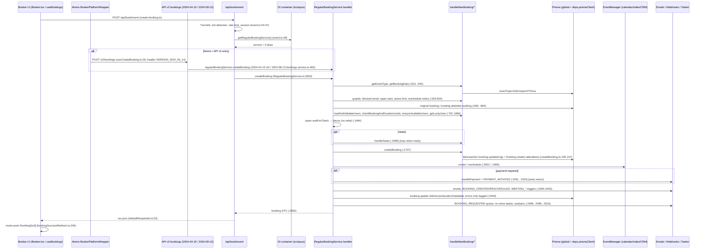

---

## date: 2026-10-25T22:28:54+01:00
researcher: Claude Code (omp agent; identity of the human operator unknown)
git_commit: 14d53ac7c7b899f6e5fab10bd0909922daf29105
branch: chore/skill-repo-map
repository: Numzon/cal.diy
topic: "Przepływ tworzenia rezerwacji (booking creation) — trace e2e, luki w testach, blast radius"
tags: [research, booking, RegularBookingService, handleNewBooking, api-v2, atoms, risk-zone]
status: complete
last_updated: 2026-10-25
last_updated_by: Claude Code (omp agent)

# Research: Przepływ tworzenia rezerwacji (booking creation)

**Data**: 2026-10-25T22:28:54+01:00
**Git Commit**: `14d53ac7c7` (HEAD, „wide scan”; rodzic `0f19cc46ef` = HEAD z repo-map). Drzewo robocze ma niezacommitowane zmiany wyłącznie w `.claude/.10x-cli-manifest.json`, `CLAUDE.md`, `context/map/repo-map.md` — żaden plik kodu przepływu nie jest zmieniony lokalnie, więc anchory `file:line` odnoszą się do HEAD.
**Branch**: `chore/skill-repo-map`
**Repository**: `https://github.com/Numzon/cal.diy`

## Research Question

„Przeanalizuj wybrany przepływ, zwracając szczególną uwagę na powiązane z nim obszary zdefiniowane w `context/map/repo-map.md`” — trzy wymiary: (1) trace e2e z `file:line` + Mermaid, (2) luki w testach, (3) blast radius (szew interfejsu, warstwy generowane, model, migracje, testy; graf statyczny + co-change z gita). Tylko stan obecny. Wymagane sekcje: **Feature overview**, **Technical debt**; rozdzielenie Evidence / Inference / Unknown.

**Wybrany przepływ (decyzja researchera):** utworzenie nowej, pojedynczej (nie-cyklicznej) rezerwacji z publicznej strony bookera — ścieżka web `POST /api/book/event` → `RegularBookingService` — oraz jej bliźniaki z repo-map (API v2 bookings, Atoms Booker). Uzasadnienie: change `booking-analysis` pochodzi z „Risk zones → 1. Booking” (`context/changes/booking-analysis/change.md:12`, `context/map/repo-map.md:119-130`), a `RegularBookingService.ts` jest najczęściej dotykanym plikiem strefy (`repo-map.md:129`). Cancel, recurring i seats wchodzą tylko jako gałęzie tej ścieżki.

**Konwencja oznaczeń:** **[E]** = evidence (zaobserwowane w kodzie/gicie, z anchorem); **[I]** = inference (wniosek); **[U]** = unknown (biała plama).

## Summary

- **[E]** Na ścieżce web wejściem jest `apps/web/pages/api/book/event.ts:17-63`: Turnstile (opcjonalnie), bot detection, rate limit, opcjonalna sesja, a potem `getRegularBookingService().createBooking(...)` z kontenera DI (`:49-58`). Cała logika domenowa siedzi w jednej funkcji modułowej `handler` w `packages/features/bookings/lib/service/RegularBookingService.ts`, w liniach 486–2578, czyli 2 093 linie. Klasa `RegularBookingService` (`:2585-2690`) ma konstruktor i 4 metody. Trzy z nich (`createBooking` `:2653-2661`, `rescheduleBooking` `:2663-2671`, `createBookingForApiV1` `:2676-2689`) identycznie wołają `handler.bind(this)(…, this.deps)` (`:2654`, `:2664`, `:2681`); wywołania w repo ma tylko `createBooking`. Czwarta, `fireBookingEvents` (`:2588-2651`), ma własną logikę (`bookingEventHandler.onBookingCreated/onBookingRescheduled`) i jest wołana zwrotnie z handlera (`this.fireBookingEvents`, `:2217`).
- **[E]** Zapis główny to `prisma.$transaction` → `tx.booking.create` (z attendees przez nested `createMany`) w `handleNewBooking/createBooking.ts:139-147`. Ten plik używa **globalnego** `prisma` (`:4`), a nie `deps.prismaClient`. Po wywołaniach zewnętrznych (EventManager: kalendarz, wideo, CRM) przychodzi drugi, osobny zapis: `booking.update` z `references.createMany`, `location` i `metadata` (`RegularBookingService.ts:2444-2463`). Jego błąd jest tylko logowany (`:2461-2463`).
- **[E]** Bliźniaki: API v2 dziedziczy tę samą klasę z `@calcom/platform-libraries/bookings` (`packages/platform/libraries/bookings.ts:10`; `apps/api/v2/src/lib/services/regular-booking.service.ts:18-41`) i ręcznie przekazuje te same 9 zależności. Atoms domyślnie wysyłają nagłówek `VERSION_2024_06_14` (`packages/platform/atoms/cal-provider/CalProvider.tsx:72`), a ta wersja jest obsługiwana przez legacy kontroler `2024-04-15` (`apps/api/v2/src/platform/bookings/2024-04-15/controllers/bookings.controller.ts:106`, `@DocsExcludeController(true)` `:109`), nie przez `2024-08-13`.
- **[E] Testy.** Pokrycie jest szerokie na poziomie serwisu (15 plików przez `getNewBookingHandler`: 14 `*.test.ts` + `spam-booking.integration-test.ts`; in-memory prismock). Brakuje testów serwisowych dla 403 z minimum-reschedule-notice, dla gałęzi `recurring_event_seats_error`, dla schedulingu `MEETING_STARTED/ENDED`, dla `handleAnalyticsEvents` i dla `noEmail`. Trasa `event.ts` nie ma testu jednostkowego. Suity integration i e2e (web, API v2) uruchamiają się w CI tylko z etykietą `ready-for-e2e` (`.github/workflows/pr.yml:284,371,385`).
- **[E] Blast radius.** Zmiana przepływu dotyka 4 szwów utrzymywanych ręcznie; poza type-checkiem (który dla API v2 działa tylko przy rozwiązaniu `platform-libraries` ze źródła) nie znaleziono dla nich dedykowanego strażnika (inspekcja: `.github/workflows`, `biome.json`, `package.json`):
  1. kontrakt zależności DI (`IBookingServiceDependencies` ↔ web `depsMap` ↔ konstruktor API v2);
  2. schemat wejścia (`bookingCreateBodySchema` ↔ mappery API v2 ↔ DTO `platform/types`);
  3. inferowany typ odpowiedzi (`ReturnType<createBooking>` ↔ web client ↔ Atoms ↔ `output.service` v2);
  4. payload webhooków (dwie rozbieżne definicje `EventPayloadType`).

  Co-change w 12 miesiącach: `RegularBookingService.ts` ma 46 commitów; z 43 commitów bez masowych refaktorów 8 dotyka plików bookings w API v2, a 3 dotykają `atoms/booker`.

## Feature overview

### Co robi przepływ (stan obecny)

Publiczny booker (web lub Atoms) wysyła zgłoszenie rezerwacji. Serwer kolejno:

1. ładuje event type;
2. waliduje wejście (zod zależny od `bookingFields`);
3. przepuszcza je przez strażników (blokady e-mail, spam, limity aktywnych rezerwacji, weryfikacja e-mail, limity bookingów i czasu trwania, granice okna czasowego);
4. ustala gospodarzy i dostępność (fixed / round-robin, lucky user);
5. buduje `CalendarEvent`;
6. zapisuje `Booking` + `Attendee`;
7. tworzy zdarzenia kalendarza i wideo przez `EventManager`;
8. wysyła e-maile i webhooki, planuje zadania no-show, aktualizuje referencje;
9. zwraca DTO.

Klient przekierowuje na `/booking/[uid]`, a w przypadku płatności na link płatności.

### Sekwencja kroków (ścieżka web)

Kolumna „Typ” rozdziela, co odczytano bezpośrednio w kodzie (anchory zweryfikowane `grep`/`read` przy HEAD w tej sesji: kroki 6–10, 12–17, 19–20, 22–23, 25, 27–29, 31–34; kroki 21, 24, 26, 30 dodatkowo potwierdzone ast-grep, patrz „Weryfikacja strukturalna”), od tego, co podał agent śledzący (kroki 1–5, 11, 18, 35; anchory przez niego cytowane, ale nie przeczytane powtórnie przez syntezę).

| # | Krok | Anchor | Typ |
|---|---|---|---|
| 1 | Submit w UI bookera → `handleBookEvent()` (lub najpierw weryfikacja e-mail) | `apps/web/modules/bookings/components/Booker.tsx:248-249,276` | E (agent) |
| 2 | `useBookings` składa `handleBookEvent` przez `useHandleBookEvent`, `handleBooking: createBookingMutation.mutate` | `apps/web/modules/bookings/hooks/useBookings.ts:412-420`; `BookerWebWrapper.tsx:169` | E (agent) |
| 3 | Rozgałęzienie klienta: recurring → `handleRecBooking`, inaczej `handleBooking(mapBookingToMutationInput(...))` | `packages/platform/atoms/hooks/bookings/useHandleBookEvent.ts:116-122` | E (agent) |
| 4 | Mapper wyliczający `start/end`, `_isDryRun`, `routedTeamMemberIds` | `packages/features/bookings/lib/client/booking-event-form/booking-to-mutation-input-mapper.tsx:35-95` | E (agent) |
| 5 | `POST /api/book/event` | `packages/features/bookings/lib/create-booking.ts:5-13`; `useBookings.ts:136-137` | E (agent) |
| 6 | Turnstile (gdy `NEXT_PUBLIC_CLOUDFLARE_USE_TURNSTILE_IN_BOOKER === "1"`) | `apps/web/pages/api/book/event.ts:20-25` | E |
| 7 | Bot detection (`FeaturesRepository`, `EventTypeRepository`) | `event.ts:28-35` | E |
| 8 | Rate limit `createBooking:<hash IP>` | `event.ts:37-40` | E |
| 9 | Sesja opcjonalna; `userId` → `-1` bez sesji; `creationSource = WEBAPP` | `event.ts:42-47,53` | E |
| 10 | DI: `getRegularBookingService()` → `createBooking({bookingData, bookingMeta})` | `event.ts:49-58`; `packages/features/bookings/di/RegularBookingService.container.ts` (14 linii) | E |
| 11 | Moduł DI: 9 zależności (prismaClient, checkBookingAndDurationLimitsService, bookingRepository, luckyUserService, userRepository, hashedLinkService, bookingEmailAndSmsTasker, bookingEventHandler, webhookProducer) | `packages/features/bookings/di/RegularBookingService.module.ts:17-34`; kontrakt `RegularBookingService.ts:423-433` | E (agent) |
| 12 | `createBooking` → `handler` | `RegularBookingService.ts:2653-2661` → `:486` | E |
| 13 | `getEventType` (dynamic → `getDefaultEvent`, inaczej `prisma.eventType.findUniqueOrThrow`) | `RegularBookingService.ts:523-526`; `handleNewBooking/getEventTypesFromDB.ts:203-204` | E |
| 14 | `validateRescheduleRestrictions` (minimum reschedule notice, 403) | wywołanie `:529-538`, definicja `:435-484` | E |
| 15 | Schemat zod z `bookingFields` + `getBookingData`; wyjęcie `_isDryRun` | `:540-549`, `:570` | E |
| 16 | `checkIfBookerEmailIsBlocked`; `getSpamCheckService()` (asynchroniczny start); `checkActiveBookingsLimitForBooker` (tylko gdy nie reschedule) | `:581`, `:594`, `:603-604` | E |
| 17 | Guard `event_type_not_found` (404) oraz seats+recurring (400) | `:640-651` | E |
| 18 | Weryfikacja kodu e-mail bookera | `:612-628` (wg agentów) | E (agent) |
| 19 | Reschedule: `getOriginalRescheduledBooking` | `:660` → `handleNewBooking/originalRescheduledBookingUtils.ts:8-10` | E |
| 20 | Dane płatności / `isConfirmedByDefault`; idempotentny short-circuit (istniejąca rezerwacja dla attendee) | `:663`; `:684` (`deps.bookingRepository.getValidBookingFromEventTypeForAttendee`) | E |
| 21 | `validateBookingTimeIsNotOutOfBounds` | `:764` | E (ast-grep) |
| 22 | `validateEventLength` (w tym `multipleDuration`) | `:772-775` | E |
| 23 | `loadAndValidateUsers` → `checkBookingAndDurationLimits` (gdy `!skipEventLimitsCheck`) | `:791`; `:816-817` | E |
| 24 | Pre-check seats (`deps.prismaClient.booking.findFirst`) | `:828-862` (wywołanie `:829-839`) | E (ast-grep) |
| 25 | Dostępność: `ensureAvailableUsers` (fixed / RR / fallback RR), `getLuckyUser` | `:902`, `:917`, `:936`, `:962`, `:1066`; `:1034` | E |
| 26 | Budowa `evt` (`CalendarEventBuilder`), uid uuidv5, `deps.prismaClient.profile.findFirst` (nie globalny `prisma`) | `:1363`, `:1268` (wg agenta), `:1312` | E (ast-grep; `:1268` agent) |
| 27 | Wynik spam checku: zablokowane → decoy booking bez zapisu do DB | `:1494-1583` | E |
| 28 | Gałąź seats: `handleSeats` (może zwrócić wcześniej) | `:1585-1586` | E |
| 29 | **Zapis**: `createBooking(...)` → `$transaction` (`booking.update` oryginału przy reschedule + `booking.create`); P2002 → 409 `BookingConflict` | `:1706-1707`; `createBooking.ts:139-147`; `:1821-1824` | E |
| 30 | `bookingSeat.create` (`deps.prismaClient`), `updateLastActiveAt` przez `new UsersRepository()` poza DI | `:1777`, `:1736-1737` | E (ast-grep) |
| 31 | `EventManager` (lub stub dla dry-run / `skipCalendarSyncTaskCreation`); reschedule → `eventManager.reschedule`, confirmed → `eventManager.create`, pending → brak wywołania | `:1834-1836`; `:1909`; `:2052` | E |
| 32 | Płatność: `handlePayment` + webhook `BOOKING_PAYMENT_INITIATED`, wczesny return | `:2291`, `:2319` | E |
| 33 | Webhooki confirmed: `scheduleTrigger` MEETING_STARTED/ENDED, `handleWebhookTrigger` BOOKING_CREATED/RESCHEDULED | `:2394`, `:2406`, `:2433` | E |
| 34 | **Zapis 2**: `booking.update` (references, location, metadata) w try/catch tylko z logowaniem; PENDING → `queueBookingRequestedWebhook`; `scheduleNoShowTriggers`; `handleAnalyticsEvents`; zwrot DTO | `:2444-2463`; `:2468`; `:2496`; `:2516`; `:2562-2577` | E |
| 35 | `defaultResponder` → `res.json`; klient: dry-run / decoy / payment / `bookingSuccessRedirect` → `/booking/${uid}` | `packages/lib/server/defaultResponder.ts:50-53`; `useBookings.ts:138-266`; `bookingSuccessRedirect.ts:246` | E (agent) |

### Diagram

### Punkty rozgałęzień

| Gałąź | Anchor | Typ |
|---|---|---|
| Recurring: klient kieruje do `/api/book/recurring-event` → `RecurringBookingService`, który woła `regularBookingService.createBooking` dla każdego slotu | `useHandleBookEvent.ts:116`; `RecurringBookingService.ts:63,106` | E (agent) |
| Dry run (`_isDryRun`): fałszywy booking, stub EventManager, pominięcia zapisów i e-maili | `RegularBookingService.ts:570`, `:1834-1836`, `:2445` | E |
| Reschedule | `:529`, `:660`, `:1909`; anulowanie oryginału w tej samej transakcji `createBooking.ts:140-141` | E |
| Seats | `:828`, `:1585-1586`, `:1777` | E |
| Requires confirmation / PENDING | short-circuit `:684`; brak `EventManager`; `queueBookingRequestedWebhook` `:2468` | E |
| Payment | `:2291-2343` (wczesny return „Payment required” wg agenta); weryfikacja credential `createBooking.ts:129-137` | E |
| Spam decoy | `:1494-1583` | E |

### Persystencja

- **[E] Zapisy.** Są cztery grupy.
  - Główna transakcja: `Booking`, a w niej zagnieżdżone `Attendee` i `Tracking`, connect do `Payment` przy płatnym reschedule oraz update oryginału przy reschedule (`createBooking.ts:122-147`).
  - Pojedyncze zapisy w serwisie: `BookingSeat` (`RegularBookingService.ts:1777`), `User.lastActiveAt` (`:1737`), `Booking.iCalUID` (`deps.prismaClient.booking.update`, `:2141-2148`), `BookingReference` + `location` + `metadata` (`:2446-2459`).
  - Poza serwisem: `Payment` przez aplikację płatniczą (`handlePayment.ts:171,179`, wg agenta) i zadania tasker no-show (`scheduleNoShowTriggers.ts:58,89`, wg agenta).
  - Licznik użycia hashed link (`BookingEventHandlerService.ts:61`, wg agenta).
- **[E] Odczyty.** `EventType` (`getEventTypesFromDB.ts:204`), users (`loadUsers.ts:133`), oryginalny booking (`BookingRepository.ts:1170`, wg agenta), istniejący booking attendee (`:684`), credentials, profile (`:1312`), busy times / schedules (przez kontenery DI w `ensureAvailableUsers.ts`).
- **[E] Modele w** `packages/prisma/schema.prisma` (wg agenta BlastRadius, odczyt `:851-931`):
  | Model / enum | Linia |
  |---|---|
  | `EventType` | 156 |
  | `BookingReference` | 801 |
  | `Attendee` | 826 |
  | `BookingStatus` | 843 |
  | `Booking` | 851 |
  | `Tracking` | 932 |
  | `Payment` | 1095 |
  | `BookingSeat` | 1330 |
  | `Task` | 1825 |

### Bliźniaki (API v2, Atoms) — powiązanie z repo-map „Risk zone 1”

- **[E] API v2** `2024-08-13`**.**
  - `bookings.service.ts:112-157` rozgałęzia się na: recurring+seated / recurring / seated / regular.
  - `createRegularBooking` (`:459-497`) robi trzy rzeczy: transformuje wejście przez `input.service.ts:97-135` (`creationSource: API_V2`), woła `regularBookingService.createBooking` (`:465`), a potem **ponownie czyta** rekord i przekształca go przez `output.service.ts:100` → `BookingOutput_2024_08_13`.
  - Wszystko to wg agenta TraceE2E.
- **[E] API v2** `2024-04-15` (wersje 04-15, 06-11, 06-14; `bookings.controller.ts:106`). `POST /` (wg agentów `:196-231`) woła serwis bezpośrednio i zwraca jego DTO bez przekształcenia. Serwerowy `defaultVersion` to `VERSION_2024_04_15` (`apps/api/v2/src/bootstrap.ts:40`).
- **[E] Atoms.** Ścieżka: `BookerPlatformWrapper.tsx:344` (`useCreateBooking`) → `http.post("/bookings", data)` (`useCreateBooking.ts:28`), body w kształcie webowym `BookingCreateBody`. Wartość domyślna `version = VERSION_2024_06_14` (`CalProvider.tsx:72`).
- **[I]** Domyślni konsumenci Atoms trafiają do legacy kontrolera 2024-04-15, wykluczonego z dokumentacji (`@DocsExcludeController(true)`, `:109`). Tylko integratorzy podający jawnie `version` trafiają do 2024-08-13. Nie sprawdzono, jak Nest rozwiązuje wersję poza `bootstrap.ts:38-40`.

## Luki w testach

### Harness

- **[E] Wejście.** Testy serwisowe wchodzą przez `handleNewBooking/test/getNewBookingHandler.ts:3-16`. Plik ten bierze **prawdziwy** kontener `getRegularBookingService()`, więc trasa `event.ts` jest pomijana.
- **[E] Baza.** Domyślnie jest to in-memory **prismock**: `packages/testing/src/lib/__mocks__/prisma.ts:72-103` (`vi.mock("@calcom/prisma")`), z resetem w `beforeEach` (`:106-111`).
- **[E] Mocki.**
  - Kalendarze i wideo: `bookingScenario.ts:63-88`.
  - Globalne (`setupVitest.ts`): wszystkie `BuildPaymentService` aplikacji płatniczych (`:147-180`), CRM (`:199-208`), globalny `fetch` (`:27-30`) — przez ten mock asertowane są webhooki.
- **[I]** Ponieważ płatności, kalendarze, wideo i CRM są mockowane, integracja z prawdziwymi providerami nie jest weryfikowana testami jednostkowymi tej ścieżki.

### Mapa pokrycia (wg agenta TestGaps; werdykty z inspekcji plików, bez uruchamiania)

| Element ścieżki | Testy (reprezentatywne) | Werdykt |
|---|---|---|
| `handler` / `createBooking` | `fresh-booking.test.ts:104` + 15 plików przez `getNewBookingHandler` | Covered |
| `getEventType` | brak dedykowanego; wykonywany pośrednio | Partial |
| `getBookingData` | `getBookingData.test.ts:66-188` (tylko lokalizacje) | Partial |
| `checkIfBookerEmailIsBlocked` | `booking-validations.test.ts:73,150` | Covered |
| Weryfikacja e-mail | `email-verification-booking.test.ts:38-355` | Covered |
| `checkActiveBookingsLimitForBooker` | `booking-validations.test.ts:214,307,407` | Covered |
| Short-circuit istniejącej rezerwacji | `fresh-booking.test.ts:3502,3560` | Covered |
| `validateRescheduleRestrictions` (403) | tylko logika UI `determineReschedulePreventionRedirect.test.ts:425-656` | **None** (serwis) |
| `validateBookingTimeIsNotOutOfBounds` | `booking-limits.test.ts:697,770` | Partial |
| `validateEventLength` | `fresh-booking.test.ts:1654` (bez `multipleDuration`) | Partial |
| `loadAndValidateUsers` | `dynamic-group-booking.test.ts`, `fresh-booking.test.ts:3622` | Partial |
| `checkBookingAndDurationLimits` | `booking-limits.test.ts:166,379`; `global-booking-limits.test.ts:70-428` | Covered (yearly `test.skip` `booking-limits.test.ts:48`) |
| `ensureAvailableUsers` | `fresh-booking.test.ts:1881-2202`; `booking-limits.test.ts:470-630` | Covered |
| Spam decoy | `spam-booking.integration-test.ts` (tylko tryb integration) | Partial |
| Seats `handleSeats` | `handleSeats/test/handleSeats.test.ts:39-2702` | Covered |
| `createBooking.ts` (zapis) | brak dedykowanego; `expectBookingToBeInDatabase` | Partial |
| Dry run | `buildDryRunBooking.test.ts:59`; `post-booking-handling.test.ts:284` | Partial |
| EventManager create/reschedule | `fresh-booking.test.ts:286-856`; `reschedule.test.ts` | Covered |
| `handleAppsStatus`, `getVideoCallDetails` | brak dedykowanych; `reschedule.test.ts:271,1305` | Partial |
| Requires confirmation | `fresh-booking.test.ts:2295-2646` | Covered |
| Payment | `fresh-booking.test.ts:2938-3382`; `handlePayment.test.ts` (mock apps) | Covered (mock) |
| BOOKING_CREATED/RESCHEDULED | `expectBookingCreatedWebhookToHaveBeenFired` | Covered |
| BOOKING_REQUESTED producer | `webhook-producer-booking-requested.test.ts:86-664` (mock producera) | Covered |
| MEETING_STARTED/ENDED (`:2390-2414`) | nie znaleziono | **None** |
| `scheduleNoShowTriggers` | `scheduleNoShowTriggers.integration-test.ts:21` (bezpośrednio, nie z serwisu) | Partial |
| `handleAnalyticsEvents` (`:2516`) | nie znaleziono | **None** |
| `noEmail` (`:2030`, `:2151`) | żaden test handleNewBooking nie ustawia | **None** |
| Trasa `event.ts` (turnstile/bot/rate limit/session) | brak testu trasy; tylko Playwright (`booking-pages.e2e.ts:144`); `BotDetectionService.test.ts:28` (unit) | Partial (e2e) |
| Web Booker UI | `Booker.test.tsx:189-249`; `bookingSuccessRedirect.test.ts:286-510` (brak testu `useBookings.ts`, mappera) | Partial |
| API v2 create | `user-bookings.e2e-spec.ts:344` i dalsze; `2024-04-15 bookings.controller.e2e-spec.ts:165`; brak unit specs | Covered (e2e only) |
| Atoms `BookerPlatformWrapper` | `packages/platform/examples/base/tests/booker-atom/booker-atom.e2e.ts:10` | Partial / weak |
| `BookingRepository` | `BookingRepository.test.ts:20-46` (tylko `getTotalBookingDuration`) | Partial |

### Gałęzie bez testu i testy podejrzane

- **[E] Brak testu serwisowego** dla:
  - `RegularBookingService.ts:466-474`: 403 minimum reschedule notice;
  - `:646-650`: `recurring_event_seats_error`;
  - `:780-788`: `teamMemberEmail` / `skipContactOwner` (oba klucze występują w testach tylko w `apps/web/test/lib/getSchedule.test.ts`, czyli dla slotów, nie dla serwisu);
  - `:2390-2414`: MEETING_*;
  - `:2516`: analytics;
  - `noEmail`;
  - `multipleDuration` w `validateEventLength`.
- **[I]** `event_type_not_found` **(**`:640-644`**) jest w praktyce martwe.** `eventType.bookingFields` jest dereferencjonowane w `:542` przed tym null-checkiem. `getEventType` dla nie-dynamicznych zdarzeń używa `findUniqueOrThrow`, więc wyjątek pada wcześniej.
- **[E] Pominięte testy:**
  - `booking-limits.test.ts:48` (`test.skip`);
  - `fresh-booking.test.ts:3861` (`test.todo` CRM);
  - `managed-event-type-booking.test.ts:10` (cały plik `test.todo`);
  - `user-bookings.e2e-spec.ts:2269` (`xit`);
  - Playwright `booking-limits.e2e.ts:79` (`fixme`).
- **[E] Duplikaty i niespójności:**
  - `fresh-booking.test.ts:3738` i `:3799` mają tę samą nazwę „domain is critical in watchlist”;
  - `global-booking-limits.test.ts:68` ma komentarz „fails on CI”, ale test nie jest pominięty.
- **[E] Integration test spamu.** `spam-booking.integration-test.ts` istnieje w HEAD i ma 388 linii (`git show c2c95b371a:<plik> | wc -l`). Commit `c2c95b371a` (2026-04-28, „remove org booking integration coverage”) **przyciął** go o 485 linii (`git diff --numstat`: `0 485`), ale go nie usunął. W wyniku agenta BlastRadius ten plik figurował jako „removed”. To było błędne i zostało skorygowane w tej syntezie.

### Co uruchamia CI

- **[E] Unit.** `unit-tests.yml` (vitest, prismock) jest bramkowany tylko przez `has-files-requiring-all-checks` (`pr.yml:313-314`). API v2 unit działa tak samo (`pr.yml:320-321`), ale nie ma booking unit specs.
- **[E] Integration, Playwright, API v2 e2e.** Wymagają etykiety `ready-for-e2e` (`pr.yml:284`, `:371-372`, `:385-386`).
- **[E] Atoms e2e.** `e2e-atoms.yml` nie jest wołany przez `pr.yml` (wg agenta TestGaps).
- **[I]** Bez etykiety PR zmieniający przepływ jest weryfikowany wyłącznie testami prismock. Kontrakt bliźniaka API v2 (e2e) i zapisy na prawdziwym Postgresie nie są wtedy sprawdzane.
- **[U]** Procent pokrycia linii i gałęzi oraz bieżący stan pass/fail. Nic nie było uruchamiane; provider v8 jest skonfigurowany w `vitest.config.mts:115`.

## Blast radius

### Graf statyczny (fan-in)

- **[E] Importery** `RegularBookingService.ts`**:** 6 plików (`git grep`): moduł DI web, `lib/dto/types.d.ts:11`, 2 testy, `RecurringBookingService.ts:6`, `packages/platform/libraries/bookings.ts:10`.
- **[E] Kontener i moduł DI:** 7 odwołań w 7 plikach (import statyczny, dynamiczny `import()` albo `vi.mock`): `event.ts:3`, `RecurringBookingService.module.ts:5`, `RegularBookingService.container.ts:3-6`, `CalendarSyncService.ts:208-210`, `getNewBookingHandler.ts:4-6`, `CalendarSyncService.test.ts:16`, `CalendarSyncService.integration.test.ts:26`. `getRegularBookingService()` ma 3 wywołania (`event.ts:49`, `CalendarSyncService.ts:211`, `getNewBookingHandler.ts:7`). Produkcyjnie są to:
  - `event.ts:3,49`;
  - `RecurringBookingService.module.ts:5`;
  - `CalendarSyncService.ts:208-212`, przez dynamiczny `import()`, niewidoczny dla grafu repo-map.
- **[E] Bliźniak API v2:** `regular-booking.service.ts:18-41` przekazuje te same 9 zależności ręcznie. Token `WEBHOOK_PRODUCER` jest stringiem (`regular-booking.tokens.ts:8`). 20 plików API v2 importuje `@calcom/platform-libraries/bookings`, a `apps/api/v2/tsconfig.json:31` mapuje tę ścieżkę na źródło. Wywołania `createBooking`:
  - `2024-08-13 bookings.service.ts:465` (`createRegularBooking`), `:507` (`createSeatedBooking`), `:766` (`rescheduleBooking`; reschedule v2 idzie przez `createBooking`, nie przez `RegularBookingService.rescheduleBooking`);
  - `2024-04-15 bookings.controller.ts:210` (`createBooking` `:197-232`, zwraca `data: booking` bez mapowania).
- **[E]** `BookingRepository.ts`**:** 57 plików ze ścieżką importu, w tym 10 testów. Jest re-eksportowany jako `PrismaBookingRepository` (`libraries/repositories.ts:4`) i podklasowany w API v2 (`prisma-booking.repository.ts:4,8`), którego importuje 13 plików.
- **[E]** `handleNewBooking/`***.** `RegularBookingService.ts` ma 22 instrukcje importu z tego folderu (`:26` i `:90-110`), z 20 różnych modułów (`createBooking` i `originalRescheduledBookingUtils` są importowane dwukrotnie: typ + wartość). Moduły `getEventType`, `loadAndValidateUsers`, `ensureAvailableUsers`, `getVideoCallDetails` i `getSeatedBooking` mają 0 importerów poza serwisem; `getLocationValuesForDb` ma 1 (test `getLocationValueForDb.test.ts:6`, import `_getLocationValuesForDb`). Importerów z zewnątrz mają:
  - `originalRescheduledBookingUtils`: 6 (5 × `import type`, 1 runtime: `tasker/BookingEmailAndSmsTaskService.ts:4`);
  - `checkBookingAndDurationLimits`: 3 (`di/containers/BookingLimits.ts:5`, `di/modules/CheckBookingAndDurationLimits.ts:1`, `libraries/bookings.ts:7`);
  - `scheduleNoShowTriggers`: 4 (produkcyjnie 2: `handleConfirmation.ts:21`, `connectAndJoin.handler.ts:3`; do tego integration test i `vi.mock`);
  - `createBooking`: 3, wszystkie `import type { Booking }` (`handleAppsStatus.ts:4`, `handleSeats/types.d.ts:8`, `moveSeatedBookingToNewTimeSlot.ts:9`); runtime importerów poza serwisem brak.

### Szwy interfejsu

| Szew | Strony | Strażnik | Anchor |
|---|---|---|---|
| Kontrakt zależności DI | `IBookingServiceDependencies` ↔ web `depsMap` ↔ konstruktor API v2 | type-check, gdy API v2 rozwiązuje libraries ze źródła | `RegularBookingService.ts:423-433`; `RegularBookingService.module.ts:17-34`; `regular-booking.service.ts:18-41` |
| Wejście | `bookingCreateBodySchema` / `extendedBookingCreateBody` / `bookingCreateSchemaLegacyPropsForApi` / `bookingCreateBodySchemaForApi` ↔ `input.service.ts:97` (08-13) ↔ kontroler 04-15 ↔ `CreateBookingInput_2024_08_13` ↔ Atoms `useCreateBooking` | brak dedykowanego; DTO v2 to ręcznie utrzymywane klasy | `packages/features/bookings/lib/bookingCreateBodySchema.ts:8,72,97,109`; `packages/platform/types/bookings/2024-08-13/inputs/create-booking.input.ts:222` |
| Odpowiedź | `return` handlera → `RegularBookingCreateResult = Awaited<ReturnType<...>>` → `BookingResponse` → web client, Atoms, 04-15 (pass-through), 08-13 `output.service.ts:100` | typ inferowany: zmiana kształtu nie łamie kompilacji kontraktu zewnętrznego 04-15 | `RegularBookingService.ts:2562-2577`; `dto/types.d.ts:48`; `bookings/types.ts:100`; `libraries/index.ts:38-39` |
| Payload webhooków | dwie definicje `EventPayloadType`: `webhooks/lib/dto/types.ts:533` (pełny `CalendarEvent`) vs `webhooks/lib/sendPayload.ts:81` (`Omit<CalendarEvent,"assignmentReason">`) | brak; repo-map odnotowuje revert `3a7122d6` „assignmentReason breaking change in webhook payloads” (`context/map/evidence/1-history.md:146`) | jw. |
| `CalendarEvent` (e-mail/kalendarz) | `packages/types/Calendar.d.ts:164` | type-check | — |

### Warstwy generowane

| Warstwa | Śledzona w git? | Związek z przepływem |
|---|---|---|
| App-store `*.generated.ts[x]` (12 plików: 11 `.ts` + `apps.browser.generated.tsx`), m.in. `payment.services.generated.ts`, `video.adapters.generated.ts`, `calendar.services.generated.ts`, `apps.schemas.generated.ts` | **Tak** | `handlePayment.ts:1`, `payment/handlePaymentRefund.ts:1`, `getPaymentAppData.ts:5` (`import type`), `getCalendar.ts:13`. Odświeżane przez `app-store-cli`; ręczne edycje są zabronione (AGENTS.md) |
| Prisma client, zod (`zod-prisma-types`), Kysely, enums | Nie (`.gitignore:72-74`) | `@zod.import` na `Booking.responses` i `Booking.metadata` wiąże `schema.prisma:859,867,893` z `zod-utils.ts` |
| `docs/api-reference/v2/openapi.json` | **Tak** (zweryfikowane: `git ls-files`; ostatnia zmiana `e91bb0c382` 2026-09-06) | generowany przez `yarn generate-swagger`; brak kroku CI sprawdzającego drift (agent: `git grep` w `.github/workflows`) |
| `platform-libraries` `dist` | Nie | API v2: `tsconfig.json:31` mapuje `@calcom/platform-libraries/bookings` na źródło; pakiet publikuje `dist` |

### Model i migracje

- **[E] Migracje** (agent BlastRadius, skan folderów `packages/prisma/migrations/`* z timestampem ≥ 20251025):
  | Zbiór | Liczba |
  |---|---|
  | Wszystkie migracje w repozytorium | 595 |
  | Migracje z tego okna | 78 |
  | …dotykające tabel bookingowych | 12 |
  | …dotykające samej tabeli `"Booking"` | 6 |

  Najnowsze bookingowe:
  - `20260319161640_drop_domain_wide_delegation`;
  - `20260305043434_remove_routing_forms`;
  - `20260128004200_add_booking_composite_indexes`.
- **[I]** Okno liczono po timestampie folderu, nie po dacie commitu.

### Co-change (git, 12 miesięcy)

- **[E] Liczba commitów:**
  | Zbiór commitów | Liczba |
  |---|---|
  | Dotyka `RegularBookingService.ts` | 46 |
  | Dotyka `handleNewBooking/` | 32 |
  | Dotyka obu | 16 |
  | `RegularBookingService.ts` bez 4 commitów >100 plików (`ab21c7f805`, `98b6d63164`, `648ad72a54`, `f5d345b133`) | 43 |
  | …z nich dotyka plików bookings w API v2 | 8 |
  | …z nich dotyka `atoms/booker` | 3 |
- **[E] Najczęstsi partnerzy** `RegularBookingService.ts`**:**
  | Plik | Wspólne commity |
  |---|---|
  | `handleCancelBooking` | 12 |
  | trpc `confirm.handler` | 11 |
  | `CalendarEventBuilder` | 11 |
  | `BookingEventHandlerService` | 9 |
  | `BookingRepository` | 9 |
  | `schema.prisma` | 9 |
  | `Calendar.d.ts` | 9 |
  | `handleConfirmation` | 9 |
  | `libraries/index.ts` | 7 |
  | `RegularBookingService.module.ts` | 6 |
  | API v2 `regular-booking.module.ts` | 6 |
  | API v2 `regular-booking.service.ts` | 5 |
  | `api/book/event.ts` | 5 |
- **[E] Po konwersji (od 2026-04-15) nie ma commitu dotykającego** `RegularBookingService.ts`**.** Commity dotykające ścieżek przepływu w tym okresie:
  - `561cf889ab` (2026-06-16): BookingRepository;
  - `91341cbba4` (2026-05-01): usunięcie triggera instant-meeting;
  - `c2c95b371a` (2026-04-28): przycięcie integration testów;
  - `46eb533dbd` (2026-05-03): literówki;
  - `ab0b9e1fb5` (2026-08-01): Booker;
  - `1dbaf8e7b4` (2026-10-18): `Calendar.d.ts`.
- **[I]** Ten wynik jest zgodny z repo-map (co-change booking–public-api 22 commity, conf 0.10; `context/map/evidence/1-history.md:179`). Mierzony inaczej (per plik, a nie per capability), daje ten sam obraz: bliźniaki zmieniają się razem z rdzeniem rzadko, w 8/43 i 3/43 commitów.

### Lista „musi zmienić się razem”

| # | Element | Typ dowodu | Pewność |
|---|---|---|---|
| 1 | `IBookingServiceDependencies` + web `RegularBookingService.module.ts` + API v2 `regular-booking.service.ts` / `regular-booking.module.ts` | statyczny + co-change (6/5) | wysoka |
| 2 | Fasada `packages/platform/libraries/{bookings,repositories,index}.ts` (+ `package.json` exports / `vite.config.js` przy nowym subpath) | statyczny + co-change (7) | wysoka |
| 3 | Kontrakt wejścia: `bookingCreateBodySchema.ts`, `getBookingDataSchema*`, `input.service.ts` (08-13), kontroler 04-15, `platform/types/bookings/2024-08-13/inputs`, Atoms hooks | statyczny / schemat | wysoka |
| 4 | Kontrakt odpowiedzi: return handlera → `dto/types.d.ts:48` → web `create-booking.ts`, Atoms `useCreateBooking.ts`, `output.service.ts` (08-13); 04-15 przepuszcza bez zmian | statyczny (typ inferowany) | wysoka |
| 5 | `openapi.json` (regeneracja ręczna) i `*.generated.ts` app-store przy zmianach aplikacji płatności/wideo | generowane | wysoka (dla zmian API v2) |
| 6 | `schema.prisma` (`Booking:851`) + migracja + `zod-utils.ts` (`@zod.import`) | schemat + co-change (9) | średnia |
| 7 | Payload webhooków: `webhooks/lib/dto/types.ts:17,533`, `sendPayload.ts:81`, `BookingPayloadBuilder.ts:65`, `Calendar.d.ts:164` | schemat + co-change (9) | średnia |
| 8 | Testy: 16 plików `handleNewBooking/test/*.test.ts` + `handleNewBooking/global-booking-limits.test.ts` + `spam-booking.integration-test.ts`, `packages/testing/.../bookingScenario.ts`, e2e API v2 `2024-08-13/controllers/e2e/` (16 specs), helpery Playwright `testUtils.ts:214`, mocki CalendarSync | statyczny | wysoka |
| 9 | Sąsiedzi domenowi: `handleCancelBooking` (12), `confirm.handler` (11), `CalendarEventBuilder` (11), `handleConfirmation` (9), `BookingEventHandlerService` (9) | co-change | średnia–niska |

## Technical debt

Każda pozycja ma anchor. Kolumna „Typ” rozdziela fakt od oceny.

| # | Dług | Dowód | Typ | Skutek |
|---|---|---|---|---|
| 1 | Monolityczny `handler`: 2 093 linie (`:486-2578`) w module-level function; 3 z 4 metod klasy tylko delegują (`handler.bind(this)` `:2654`, `:2664`, `:2681`), a jedyna z własną logiką (`fireBookingEvents`, `:2588-2651`) jest wołana zwrotnie z handlera (`:2217`) | `RegularBookingService.ts:486`, `:2578`, `:2588-2689` | E | **[I]** Trudność testowania gałęzi w izolacji. Tłumaczy co-change z 9+ plikami i 44 dotknięcia z repo-map |
| 2 | Niepełne DI: sam `RegularBookingService.ts` nie używa globalnego `prisma` (6 wywołań przez `deps.prismaClient`: `:829`, `:1312`, `:1777`, `:2141`, `:2258`, `:2446`), ale 10 produkcyjnych plików `handleNewBooking/*.ts` importuje globalny `prisma`, w tym zapis główny i lookup oryginału. Do tego `new UsersRepository()` (`:1736`) omija wstrzyknięty `deps.userRepository` | `createBooking.ts:4,130,139`; `originalRescheduledBookingUtils.ts:4,7-9` („// TODO: Inject.”); globalny `prisma` także w `checkActiveBookingsLimitForBooker.ts:4`, `checkIfBookerEmailIsBlocked.ts:5`, `ensureAvailableUsers.ts:15`, `findBookingQuery.ts:2` (tylko seats), `getEventTypesFromDB.ts:7`, `getSeatedBooking.ts:1`, `loadAndValidateUsers.ts:12`, `loadUsers.ts:10`; TODO usunięcia `prismaClient` w `RegularBookingService.module.ts:23` | E | **[I]** W API v2 transakcja `booking.create` i większość odczytów nie przechodzi przez klienta wstrzykniętego przez Nest (`PrismaWriteService`) |
| 3 | Brak atomowości: `booking.create` (tx) → wywołania zewnętrzne `EventManager` → osobny `booking.update` references/location/metadata; błąd drugiego zapisu tylko logowany | `createBooking.ts:139-147`; `RegularBookingService.ts:2444-2463` | E | **[I]** Możliwy booking bez `BookingReference` mimo istniejącego zdarzenia w kalendarzu |
| 4 | Martwy kod / flagi: `createBookingForApiV1` bez wywołań (`apps/api/v1` usunięte w `ab21c7f805`); `rescheduleBooking` wymagany przez `IBookingService` (`interfaces/IBookingService.ts:8`), ale bez wywołań; `isBookingEmailSmsTaskerEnabled = false` na sztywno, więc gałąź `bookingEmailAndSmsTasker.send` jest nieosiągalna; `hashedLinkService` jest wstrzykiwany, ale serwis go nie czyta (konsumuje go `BookingEventHandlerService.ts:61` przez własny DI, `BookingEventHandlerService.module.ts:17`) | `RegularBookingService.ts:2676`, `:2663` (0 wywołań); `:2215`, `:2530`, `:2532`; `:429` (0 odczytów `deps.hashedLinkService`) | E | **[I]** Mylący kod przy zmianach; 2 z 9 elementów kontraktu DI (#1 w blast radius) są na tej ścieżce martwe |
| 5 | Nieosiągalny guard `event_type_not_found` | `:542` (dereferencja) przed `:640` (null-check) | I | Błędny kod HTTP przy braku event type; zależy od zachowania `getEventType` |
| 6 | Dwa rozbieżne typy `EventPayloadType` | `webhooks/lib/dto/types.ts:533` vs `webhooks/lib/sendPayload.ts:81` | E | Historyczny revert kontraktu `3a7122d6` (`1-history.md:146`) dotyczył właśnie `assignmentReason` |
| 7 | Kontrakt odpowiedzi tylko inferowany (`ReturnType`), a wersja 04-15 (domyślna dla Atoms) zwraca go bez mapowania | `dto/types.d.ts:48`; `CalProvider.tsx:72`; `2024-04-15/.../bookings.controller.ts:106,109` | E + I | **[I]** Dowolna zmiana pól w `return` handlera zmienia publiczny kontrakt zewnętrznych konsumentów Atoms, bez strażnika |
| 8 | Ręcznie duplikowane wiązanie DI w web i API v2 (9 zależności, token stringowy) | `RegularBookingService.module.ts:17-34`; `regular-booking.service.ts:18-41`; `regular-booking.tokens.ts:8` | E | Dwa miejsca do zmiany przy każdej nowej zależności |
| 9 | Brak strażnika driftu `openapi.json` i brak wpięcia `.dependency-cruiser.cjs` | `.dependency-cruiser.cjs` śledzony od `14d53ac7c7` (2026-10-25), bez odwołań w `package.json` / `.github` (wg agenta); egzekwowane jest tylko Biome `noRestrictedImports` (`biome.json:311-330,418-440`, `lint.yml:18`) | E | — |
| 10 | Testy: brak testów 403 reschedule-notice, MEETING_*, analytics, `noEmail`, trasy `event.ts`; `test.skip` / `test.todo` / `xit`; duplikat nazwy testu; e2e i integration tylko z etykietą | sekcja „Luki w testach” | E | **[I]** PR bez `ready-for-e2e` nie weryfikuje bliźniaka API v2 |
| 11 | Markery TODO na ścieżce: 11 trafień w 6 plikach (zakres: `RegularBookingService.ts` + pliki najwyższego poziomu `handleNewBooking/*.ts`; `git grep -n -E "TODO\|FIXME\|HACK\|XXX"`); dodatkowo 4 w `handleNewBooking/test/fresh-booking.test.ts`, 0 w `event.ts` | `RegularBookingService.ts:1292,1298,2129,2330,2551`; `loadAndValidateUsers.ts:110` („Establish whether this is dead code”), `:136`; `loadUsers.ts:118`; `getLocationValuesForDb.ts:35`; `originalRescheduledBookingUtils.ts:7`; `global-booking-limits.test.ts:10` | E | — |
| 12 | Resztki EE: gałęzie ROUND_ROBIN / team / org nadal w handlerze i testach (`testWithAndWithoutOrg`), mimo usunięcia zespołów i org w `ab21c7f8`; modele `Team` / `Membership` / `Profile` nadal istnieją | `RegularBookingService.ts:666` (wg agenta); `schema.prisma:534,557,744` (wg agenta) | E + U | **[U]** Czy ścieżki team/RR są osiągalne w Cal.diy |
| 13 | Powtórzony kształt wywołań przy reschedule: `getSeatedBooking` + `getOriginalRescheduledBooking` wykonują się dwa razy na żądanie, najpierw w `validateRescheduleRestrictions`, potem w `handler` | `:448`, `:456-459`; `:653`, `:660` | E | **[I]** Podwójne zapytania do DB przy każdym reschedule; dwie ścieżki do utrzymania w spójności |

## Weryfikacja strukturalna (ast-grep)

Twierdzenia strukturalne raportu (liczby call-site'ów, „tylko tutaj”, „zawsze przez X”, liczność metod i zależności, powtarzające się kształty wywołań) sprawdzono przy HEAD narzędziem `ast-grep` 0.51.0 (`run -p` albo `scan --inline-rules`, osobno dla języków `TypeScript` i `Tsx`). Każde zero z ast-grep porównano z `git grep -n -E`, żeby odróżnić realny brak wystąpień od złego wzorca.

**Pułapki wzorców wykryte przy kontroli zer:**

- wywołanie generyczne `f<T>(…)` nie pasuje do `f($$$)`; działają `http.post<$$$T>($$$A)` i `await f<$T>($$$A)`. W przypadku `await f<T>(…)` parser ast-grep 0.51 nie tworzy węzła `call_expression` (identyfikator jest bezpośrednim dzieckiem `await_expression`), więc zero daje też reguła `kind: call_expression`;
- sam identyfikator (`createBookingForApiV1`) nie trafia w nazwę metody (`property_identifier`); trzeba `$O.m($$$)` albo reguły `kind: method_definition`;
- `getLuckyUser($$$)` nie trafia w `deps.luckyUserService.getLuckyUser(...)`; wywołanie metody wymaga `$S.getLuckyUser($$$)`;
- wzorzec `klucz: $V` parsuje się jako labeled statement; klucze obiektów trzeba szukać regułą `kind: pair` z `field: key`;
- reguła na import nazwany musi schodzić w głąb (`stopBy: end`); import `{ prisma }` w `getEventTypesFromDB.ts:7` wyłapał dopiero `git grep`;
- `-l ts` pomija pliki `.tsx` (`BookingRepository`: 54 zamiast 57 plików, łącznie z importem względnym);
- na Windows wrapper `ast-grep.cmd` obcina wieloliniowe `--inline-rules`; trzeba wołać natywny `ast-grep.exe`.

| # | Twierdzenie raportu | Wzorzec / reguła ast-grep | Wynik (pliki:linie) | Zero → `git grep` | Werdykt |
|---|---|---|---|---|---|
| 1 | `handler` to jedna funkcja modułowa `:486-2578` (2 093 linie) | `async function handler($$$) { $$$ }` | 1: `RegularBookingService.ts:486-2578` | — | **potwierdzone** |
| 2 | Klasa to tylko fasada; `createBooking` deleguje do `handler` | `method_definition` w `class_body` klasy `RegularBookingService`; `handler.bind($T)($$$)`; `this.fireBookingEvents($$$)` | 5 członków: ctor `:2586`, `fireBookingEvents` `:2588-2651`, `createBooking` `:2653-2661`, `rescheduleBooking` `:2663-2671`, `createBookingForApiV1` `:2676-2689`; `handler.bind` 3× (`:2654`, `:2664`, `:2681`); `this.fireBookingEvents` 1× (`:2217`) | — | **doprecyzowane**: 3 metody delegują identycznie; `fireBookingEvents` ma własną logikę i jest wołana z handlera |
| 3 | `createBookingForApiV1` nie ma wywołań | `$O.createBookingForApiV1($$$)`; identyfikator `createBookingForApiV1` | 0; 0 | 1 linia (definicja `:2676`). Zero z wzorca identyfikatora to zły wzorzec; zero z wywołania to realny brak | **potwierdzone** |
| 4 | (nowe) `RegularBookingService.rescheduleBooking` | `$X.rescheduleBooking($$$)`; `$O.regularBookingService.rescheduleBooking($$$)` | 26 trafień, żadne na instancji `RegularBookingService` (25 × `CalendarSyncService` z testami, 1 × `this.bookingsService` w v2 `2024-08-13/.../bookings.controller.ts:328`); 0 | `regularBookingService.rescheduleBooking`: 0 linii → realny brak | **nowe**: metoda wymagana przez `IBookingService.ts:8`, bez wywołań (dług #4) |
| 5 | Zapis główny: globalny `prisma` (`createBooking.ts:4`), `$transaction` → `tx.booking.create` `:139-147` | `import $P from "@calcom/prisma"`; `prisma.$transaction($$$)`; `$TX.booking.create($$$)`; `$TX.booking.update($$$)`; `deps.prismaClient` | `:4`; `:139-147`; `:144`; `:141` (anulowanie oryginału); 0 | `\bdeps\b` w pliku: 0 → realny brak | **potwierdzone** (oraz globalny `prisma.credential.findFirstOrThrow` `:130`) |
| 6 | Drugi zapis `booking.update` (references/location/metadata) `:2444-2463`, błąd tylko logowany | `$P.booking.update($$$)`; `try_statement`, którego body zawiera (`stopBy: end`) `deps.prismaClient.booking.update($$$)`; `pair` z kluczem `createMany` | 2 × `deps.prismaClient.booking.update`: `:2141-2148` (iCalUID) i `:2446-2459`; try `:2444-2463` (catch tylko `tracingLogger.error`); `createMany` `:2454` | wzorzec `try { $$$ X $$$ } catch` dał 0, bo update jest zagnieżdżony w `if (!isDryRun)` (zły wzorzec); reguła z `stopBy: end` → 1 | **potwierdzone**; w serwisie są 2 zapisy `booking.update`, nie 1 |
| 7 | 9 zależności: interfejs ↔ web `depsMap` ↔ konstruktor API v2 | `property_signature` w `IBookingServiceDependencies`; `pair` w obiekcie `depsMap`; `required_parameter` konstruktora; właściwości w `super({...})` | 9 (`RegularBookingService.ts:424-432`); 9 (`RegularBookingService.module.ts:24-32`); 9 (`regular-booking.service.ts:20-28`); 9 (`:31-39`) | — | **potwierdzone** |
| 8 | (nowe) Użycie każdej z 9 zależności w serwisie | `deps.<nazwa>`, `this.deps.<nazwa>`; `identifier` `deps` poza `member_expression` | `checkBookingAndDurationLimitsService` `:817`; `prismaClient` `:829`, `:1312`, `:1777`, `:2141`, `:2258`, `:2446`; `bookingRepository` `:684`; `luckyUserService` `:1034`; `userRepository` `:1224`; `bookingEmailAndSmsTasker` `:2532` (gałąź nieosiągalna); `bookingEventHandler` `:2627`; `webhookProducer` `:2468`; `hashedLinkService` 0. `deps` nie jest przekazywane dalej (poza dostępem do pól tylko deklaracje `:489`, `:2586`) | `deps\.hashedLinkService`: 0 → realny brak | **nowe**: `hashedLinkService` martwy w kontrakcie (dług #4) |
| 9 | `isBookingEmailSmsTaskerEnabled = false` → `bookingEmailAndSmsTasker.send` nieosiągalne | `isBookingEmailSmsTaskerEnabled`; `$A.bookingEmailAndSmsTasker` | `:2215` (stała `false`), `:2530` (guard); `:2532` | — | **potwierdzone** |
| 10 | Testy serwisowe: ~20 plików przez `getNewBookingHandler` | import / `import()` ze stringiem `getNewBookingHandler` | 15 plików: 13 w `handleNewBooking/test/` (w tym `spam-booking.integration-test.ts`), `handleNewBooking/global-booking-limits.test.ts`, `handleSeats/test/handleSeats.test.ts` | 15 plików | **obalone** (~20 → 15) |
| 11 | Brak testu serwisowego dla 403 minimum reschedule notice | `pair` z kluczem `minimumRescheduleNotice` w `handleNewBooking/**`, `handleSeats/test` (pierwszy przebieg wzorcem `minimumRescheduleNotice: $V` dał fałszywe 0: ten sam wzorzec daje 0 w całym `bookings/lib`, gdzie reguła `pair` znajduje 17 trafień) | 1 trafienie, nietestowe (`select` w `getEventTypesFromDB.ts:24`); w plikach testów 0 | trafienia w testach tylko w `reschedule/determineReschedulePreventionRedirect.test.ts` (logika UI) → realny brak | **potwierdzone** |
| 12 | Brak testu dla `recurring_event_seats_error` | `"recurring_event_seats_error"` w `apps`, `packages` | 2, oba produkcyjne: `RegularBookingService.ts:649`, `atoms/event-types/hooks/useEventTypeForm.ts:328` | poza nimi tylko pliki i18n; 0 testów | **potwierdzone** |
| 13 | Brak testu dla MEETING_STARTED/ENDED | `WebhookTriggerEvents.MEETING_STARTED` / `.MEETING_ENDED` w testach serwisu | 0 / 0 (w serwisie: opcje subskrybenta `:1479`, `:1488`; `scheduleTrigger` `:2394`, `:2406`) | `MEETING_STARTED\|MEETING_ENDED` w testach serwisu i `packages/testing`: 0 → realny brak | **potwierdzone** |
| 14 | Brak testu dla `handleAnalyticsEvents` | identyfikator `handleAnalyticsEvents` | 3: definicja `tasker/tasks/analytics/handleAnalyticsEvents.ts:16`, import `:43`, wywołanie `:2516`; 0 w testach | te same 3 | **potwierdzone** |
| 15 | Brak testu dla `noEmail` | `pair` z kluczem `noEmail` w testach serwisu | 2: `handleSeats.test.ts:211`, `:351`, oba `noEmail: undefined` | te same + typ `getBookingData.ts:100` | **doprecyzowane**: klucz występuje, ale żaden test nie ustawia `true` |
| 16 | Brak testu dla `teamMemberEmail` / `skipContactOwner` i `multipleDuration` | `pair` z tymi kluczami w testach serwisu | 0 / 0 / 0 | 0 w testach serwisu; `teamMemberEmail` / `skipContactOwner` tylko w `apps/web/test/lib/getSchedule.test.ts` (sloty) → realny brak | **potwierdzone** |
| 17 | Brak testu trasy `event.ts` | import / `import()` / `vi.mock` ścieżki `api/book/event` | 0 | `"/api/book/event"`: tylko Playwright (`testUtils.ts:214,578,583`), e2e embed, klient `create-booking.ts:13`, `calendso.yaml:227` → realny brak | **potwierdzone** |
| 18 | Importery `RegularBookingService.ts`: 6 | import/eksport ze ścieżką kończącą się `RegularBookingService` | 6: `RegularBookingService.module.ts:2`, `dto/types.d.ts:11`, `buildDryRunBooking.test.ts:3`, `computeTeamData.test.ts:5`, `RecurringBookingService.ts:6`, `libraries/bookings.ts:10` | — | **potwierdzone** |
| 19 | Kontener i moduł DI: 10 trafień | import / `import()` / `vi.mock` ze ścieżką `RegularBookingService.container` lub `.module`; `getRegularBookingService()` | 7 odwołań w 7 plikach; 3 wywołania (`event.ts:49`, `CalendarSyncService.ts:211`, `getNewBookingHandler.ts:7`) | 15 linii w tych samych 7 plikach | **doprecyzowane**: liczby „10” nie da się odtworzyć; lista konsumentów produkcyjnych bez zmian |
| 20 | 20 plików API v2 importuje `@calcom/platform-libraries/bookings` | `import_statement` z tym stringiem | 20 plików | 21 = 20 + `apps/api/v2/tsconfig.json:31` (mapowanie ścieżki) | **potwierdzone** |
| 21 | Wywołania `createBooking` w API v2: 08-13 `:465,507,766`; 04-15 `:210` | `$X.regularBookingService.createBooking($$$)` + `method_definition` zawierający to wywołanie | 4: `bookings.service.ts:465` (`createRegularBooking` `:459-497`), `:507` (`createSeatedBooking` `:499-552`), `:766` (`rescheduleBooking` `:743-822`); `2024-04-15/.../bookings.controller.ts:210` (`createBooking` `:197-232`) | — | **potwierdzone** (dodano metody otaczające) |
| 22 | Recurring woła `regularBookingService.createBooking` dla każdego slotu | `$X.createBooking($$$)` w `RecurringBookingService.ts` | `:63-70`, `:106-113` | — | **potwierdzone** |
| 23 | `BookingRepository.ts`: 57 plików, w tym 10 testów; re-eksport i podklasa v2 z 13 importerami | importy ze ścieżką kończącą się `/BookingRepository` (TS + Tsx); `export { $$$ } from ".../BookingRepository"`; `class_declaration` z `class_heritage` ~ `BookingRepository`; importy `prisma-booking.repository` | 57 / 10; `libraries/repositories.ts:4`; `prisma-booking.repository.ts:8-12`; 13 | 57 / 13 | **potwierdzone** |
| 24 | `RegularBookingService.ts` ma 22 importy z `handleNewBooking/` (`:90-110`) | `import_statement` ze stringiem `handleNewBooking/` | 22 instrukcje: `:26` + `:90-110`; 20 różnych modułów | — | **doprecyzowane** (zakres linii, liczba modułów) |
| 25 | Fan-in modułów `handleNewBooking/`: 0 dla sześciu modułów; `originalRescheduledBookingUtils` 4, `checkBookingAndDurationLimits` 3, `scheduleNoShowTriggers` 3, `createBooking` 2 | importy per moduł (TS + Tsx) | `getEventType`, `loadAndValidateUsers`, `ensureAvailableUsers`, `getVideoCallDetails`, `getSeatedBooking`: 0; `getLocationValuesForDb`: 1 (test); `originalRescheduledBookingUtils`: 6; `checkBookingAndDurationLimits`: 3; `scheduleNoShowTriggers`: 4; `createBooking`: 3 (tylko typy) | zera: 0 linii → realny brak | **doprecyzowane** (4 z 10 liczb się zmieniły) |
| 26 | Dwie rozbieżne definicje `EventPayloadType` | `type_alias_declaration` / `interface_declaration` o nazwie `EventPayloadType` | 2: `webhooks/lib/sendPayload.ts:81-104` (`Omit<CalendarEvent,"assignmentReason">`), `webhooks/lib/dto/types.ts:533-550` | — | **potwierdzone** |
| 27 | Globalny `prisma` tylko w zapisie głównym i lookupie oryginału | `prisma.$M.$OP($$$)` i `deps.prismaClient.$M.$OP($$$)` w serwisie; import domyślny `@calcom/prisma` w `handleNewBooking/` | serwis: 0 / 6; `handleNewBooking/*.ts` produkcyjnie: 9 importów domyślnych + `getEventTypesFromDB.ts:7` (import nazwany) | `\bprisma\.` w serwisie: 0 → realny brak | **doprecyzowane** (zasięg 10 plików, dług #2) |
| 28 | `originalRescheduledBookingUtils` tworzy `new BookingRepository(prisma)` | `new BookingRepository($A)`; import | `:9`; `:4` | — | **potwierdzone** |
| 29 | Martwy guard `event_type_not_found` | `eventType.bookingFields`; `"event_type_not_found"` | `:542` (przed guardem), `:2308`; `:643` (guard `:640-644`) | — | **potwierdzona kolejność**; sama nieosiągalność zostaje [I] (zależy od `getEventType`) |
| 30 | Pominięte testy | `test.skip` / `test.todo` / `xit` / `test.fixme` / `*.only($$$)` w testach serwisu, API v2 bookings i Playwright | `booking-limits.test.ts:48`; `fresh-booking.test.ts:3861`; `managed-event-type-booking.test.ts:10`; `user-bookings.e2e-spec.ts:2269`; `booking-limits.e2e.ts:79`. Dodatkowo w Playwright bookingowym: `dynamic-booking-pages.e2e.ts:148` (bezwarunkowy `test.skip`) oraz warunkowe `payment.e2e.ts:16`, `reschedule.e2e.ts:241`, `booking-pages.e2e.ts:648`; `.only`: 0 | 31 linii, zgodne | **potwierdzone + uzupełnione** |
| 31 | Duplikat nazwy testu `fresh-booking.test.ts:3738` / `:3799` | pierwszy argument-string wywołań `test` / `it` / `testWithAndWithoutOrg` | 172 tytuły w testach serwisu i seats; jedyny duplikat w obrębie pliku: `:3738`, `:3799` | 2 | **potwierdzone** (jedyny) |
| 32 | Markery TODO: 11 w 6 plikach; 4 w `fresh-booking.test.ts`; 0 w `event.ts` | `kind: comment` + regex `TODO\|FIXME\|HACK\|XXX` | 11 w 6 plikach; 4 (`:686`, `:2761`, `:3079`, `:3203`); 0 | 11 / 0 | **potwierdzone** |
| 33 | Kotwice wywołań w tabeli sekwencji | wzorzec wywołania dla każdego kroku | `getEventType` `:523`, `validateRescheduleRestrictions` `:529`, `getBookingData` `:545`, `checkIfBookerEmailIsBlocked` `:581`, `getSpamCheckService` `:594`, `checkActiveBookingsLimitForBooker` `:604`, `getValidBookingFromEventTypeForAttendee` `:684`, `validateBookingTimeIsNotOutOfBounds` `:764`, `validateEventLength` `:772`, `loadAndValidateUsers` `:791`, `checkBookingAndDurationLimits` `:817`, `ensureAvailableUsers` ×5 (`:902`, `:917`, `:936`, `:962`, `:1066`), `getLuckyUser` `:1034`, `handleSeats` `:1586`, `createBooking` `:1707`, `updateLastActiveAt` `:1737`, `new EventManager` ×2 (`:1835`, `:1869`), `eventManager.reschedule` `:1909`, `eventManager.create` `:2052`, `handlePayment` `:2291`, `handleWebhookTrigger` ×2 (`:2319`, `:2433`), `scheduleTrigger` ×2 (`:2394`, `:2406`), `queueBookingRequestedWebhook` `:2468`, `scheduleNoShowTriggers` `:2496`, `handleAnalyticsEvents` `:2516` | zera dla `getLuckyUser($$$)`, `queueBookingRequestedWebhook($$$)` (metody) i `validateBookingTimeIsNotOutOfBounds($$$)` (generyk): po 1 linii → złe wzorce, poprawione | **potwierdzone**; krok 26 doprecyzowany (`deps.prismaClient.profile.findFirst`), kroki 21, 24, 26, 30 nie są już tylko „wg agenta” |
| 34 | (nowe) Powtórzony kształt: lookup rezerwacji przy reschedule | `getSeatedBooking($$$)`; `getOriginalRescheduledBooking($$$)` | 2 + 2: `:448` / `:456` (w `validateRescheduleRestrictions`) i `:653` / `:660` (w `handler`) | — | **nowe** (dług #13) |
| 35 | Atoms: `http.post("/bookings")` w `useCreateBooking.ts:28` | `http.post($$$)`; `http.post<$$$T>($$$A)` | 0; 3 (`useCreateBooking.ts:28`, `useCreateRecurringBooking.ts:30`, `useCancelBooking.ts:29`) | 3 → pierwsze zero to zły wzorzec (generyk) | **potwierdzone** |
| 36 | Kontroler 04-15 obsługuje 04-15/06-11/06-14 i ma `@DocsExcludeController(true)`; token `WEBHOOK_PRODUCER` to string | `kind: decorator`; `export const WEBHOOK_PRODUCER = $V` | `2024-04-15/.../bookings.controller.ts:104-107` (`version: [VERSION_2024_04_15, VERSION_2024_06_11, VERSION_2024_06_14]`), `:109`; kontroler 08-13 `:80-83` bez `DocsExcludeController`; `regular-booking.tokens.ts:8` | — | **potwierdzone** |
| 37 | API v2 nie ma własnej logiki tworzenia; 08-13 ponownie czyta rekord, 04-15 przepuszcza wynik | `$P.booking.create($$$)` w `apps/api/v2/src`; `this.$R.$M($$$)` w `createRegularBooking` | 0; `createBookingRequest` `:464` → `createBooking` `:465` → `getByUidWithAttendeesAndUserAndEvent` `:483` → `getOutputBooking` `:488`; 04-15 zwraca `data: booking` (`:224-227`) | `\.booking\.create\(` w `apps/api/v2/src`: 0 → realny brak | **potwierdzone** |
| 38 | Zagnieżdżone zapisy w transakcji: Attendee, Tracking, connect Payment | `pair` (`attendees`, `user`, …) z wartością-obiektem zawierającym `create` / `createMany` / `connect` | `attendees.createMany` `createBooking.ts:198-202`, `user.connect` `:207-211`; Tracking `:219` (`tracking ? { create: tracking } : undefined`, wartość warunkowa, więc wzorzec obiektowy jej nie łapie; potwierdzone grepem); Payment `connect` przez przypisanie `:125` | — | **potwierdzone** (z kotwicami) |
| 39 | 12 plików `*.generated.ts`; importują je `handlePayment.ts:1`, `getPaymentAppData.ts:5`, `getCalendar.ts:13` | glob + import ze stringiem kończącym się `.generated` | 12 = 11 `.ts` + `apps.browser.generated.tsx` (wszystkie śledzone); importy zgodne (`getPaymentAppData.ts:5` to `import type`), dodatkowo `payment/handlePaymentRefund.ts:1` | — | **doprecyzowane** |
| 40 | 17 plików `handleNewBooking/test/*.test.ts`; 16 specs e2e 08-13 | `git ls-files` / glob (liczba plików, bez AST) | 16 (+ `handleNewBooking/global-booking-limits.test.ts` poziom wyżej = 17); 16 | — | **doprecyzowane / potwierdzone** |
| 41 | Schematy wejścia `bookingCreateBodySchema.ts:8,72,97` | `export const $N = $V` | 4: `:8`, `:72`, `:97`, `:109` (`bookingCreateBodySchemaForApi`) | — | **doprecyzowane** |

**Bilans:** 41 wierszy = 38 twierdzeń raportu + 3 nowe ustalenia (#4, #8, #34). Potwierdzone: 27 (w tym #30 uzupełnione o dodatkowe skipy, #33 z korektą kroku 26). Doprecyzowane: 10 (w #29 potwierdzona jest kolejność, a sama nieosiągalność zostaje [I]). Obalone: 1 (#10, ~20 → 15 plików). Korekty nie zmieniają wniosków o szwach i ryzyku. Wzmacniają dług #2 (zasięg globalnego `prisma`) i #4 (martwe elementy kontraktu DI), a dodają dług #13.

## Code References

- `apps/web/pages/api/book/event.ts:17-63`: trasa wejściowa web.
- `packages/features/bookings/di/RegularBookingService.container.ts`, `.module.ts:17-34`: DI web.
- `packages/features/bookings/lib/service/RegularBookingService.ts:423-433` (kontrakt deps), `:435-484` (reschedule restrictions), `:486-2578` (handler), `:2585` (klasa), `:2588-2651` (`fireBookingEvents`), `:2653-2661` (`createBooking`), `:2663-2671` (`rescheduleBooking`), `:2676` (`createBookingForApiV1`).
- `packages/features/bookings/lib/handleNewBooking/createBooking.ts:139-147`: transakcja zapisu.
- `packages/features/bookings/lib/handleNewBooking/originalRescheduledBookingUtils.ts:7-10`: `new BookingRepository(prisma)`.
- `packages/platform/libraries/bookings.ts:10`: fasada dla API v2.
- `apps/api/v2/src/lib/services/regular-booking.service.ts:18-41`: podklasa Nest.
- `apps/api/v2/src/platform/bookings/2024-08-13/services/bookings.service.ts:459-497`: create regular v2.
- `apps/api/v2/src/platform/bookings/2024-04-15/controllers/bookings.controller.ts:106,109`: legacy wersje, wykluczone z dokumentacji.
- `apps/api/v2/src/bootstrap.ts:38-40`: domyślna wersja API.
- `packages/platform/atoms/cal-provider/CalProvider.tsx:72`: domyślna wersja Atoms.
- `packages/features/bookings/lib/handleNewBooking/test/getNewBookingHandler.ts:3-16`: wejście testów.
- `packages/testing/src/lib/__mocks__/prisma.ts:72-111`: prismock.
- `.github/workflows/pr.yml:284,313-321,371-386`: bramkowanie testów.

## Architecture Insights

- **[E]** Warstwy na ścieżce: trasa Next (pages API) → kontener DI ioctopus → serwis (de facto proceduralny handler) → helpery `handleNewBooking/`* → mieszanka repozytoriów (`deps.bookingRepository`), `deps.prismaClient` i globalnego `prisma`. Reguła z AGENTS.md („no business logic in repositories”) jest zachowana. Odwrotny kierunek, czyli dostęp do danych poza repozytoriami, nie jest egzekwowany.
- **[E]** API v2 nie ma własnej logiki tworzenia rezerwacji. Używa rdzenia przez fasadę `platform-libraries` i dodaje mapowanie wejścia i wyjścia (08-13) albo przepuszcza wynik bez zmian (04-15).
- **[I]** Rdzeń jest „single source of truth” dla logiki. Ryzyko bliźniaków z repo-map (`repo-map.md:101,130`) leży więc nie w duplikacji logiki, tylko w **kontraktach na brzegach**: DI, wejście, inferowana odpowiedź i payload webhooków.

## Historical Context (from prior changes)

Brak innych zmian w `context/changes/**` ani w `context/archive/**` (glob: tylko `booking-analysis/change.md` i README). Weryfikacja twierdzeń z `context/map/repo-map.md` dotyczących tego przepływu:

| Twierdzenie repo-map | Werdykt | Dowód |
|---|---|---|
| Entry route `apps/web/pages/api/book/event.ts` (oznaczone `inference`, `:181`) | **supported** | `event.ts:49-58` |
| „Booker UI in `packages/features/bookings/Booker/`” (`:181`) | **partial** | Store, hooki i komponenty są tam. Komponent submitu to `apps/web/modules/bookings/components/Booker.tsx`, a mutacja jest w `apps/web/modules/bookings/hooks/useBookings.ts` (agent TraceE2E) |
| Zmiana wymaga też zmiany w `apps/api/v2/src/platform/bookings` i `atoms/booker`; „nothing links them mechanically” (`:130`) | **partial** | Logika jest współdzielona (dziedziczenie przez `platform-libraries`), więc zmiana logiki dociera do API v2 bez kopiowania. Mechanicznego łącznika brak dla kontraktów DI, wejścia i odpowiedzi |
| `.dependency-cruiser.cjs` „untracked, unwired” (`:103,201`) | **partial** | Od `14d53ac7c7` (2026-10-25) jest śledzony; nadal niewpięty. Częściowe egzekwowanie granic zapewnia Biome `noRestrictedImports` w CI |
| `openapi.json` „deleted at HEAD” (`:109,202`) | **contradicted** | `docs/api-reference/v2/openapi.json` jest śledzony; ostatnia zmiana `e91bb0c382` (2026-09-06) |
| „unknown whether `apps/api/v2` builds `platform-libraries` from source or pins a published build” (`:140,200`) | **partial** | Zależność `workspace:`* (`apps/api/v2/package.json:45`), a `tsconfig.json:31` mapuje na źródło (type-check). Runtime zależy od zbudowanego `dist` (agent) — pozostaje [U] |
| Co-change booking–public-api 22, conf 0.10 (`evidence/1-history.md:179`) | **supported** (innym pomiarem) | 8/43 commitów `RegularBookingService.ts` z API v2 bookings |

## Related Research

Nie dotyczy: brak innych `research.md` w `context/changes/**` i `context/archive/**`.

## Open Questions

1. **[U]** Do jakich klas DI rozwiązują się zależności w runtime (loadery `features/di/modules/`*), jaka jest implementacja `webhookProducer` i backendu tasker. Agenci nie otworzyli tych plików.
2. **[U]** Czy API v2 w runtime używa `platform-libraries` ze źródła czy z `dist`. To decyduje, kiedy zmiana rdzenia trafia do API.
3. **[U]** Rzeczywiste pokrycie linii i gałęzi oraz stan pass/fail testów (nic nie uruchamiano).
4. **[U]** Czy gałęzie team / round-robin / org są osiągalne w Cal.diy po usunięciu EE, i czy testy `testWithAndWithoutOrg` przechodzą.
5. **[U]** Kto konsumuje Atoms i API v2 poza repozytorium. Domyślna wersja Atoms kieruje do niedokumentowanego kontrolera 04-15.
6. **[U]** Linie `RegularBookingService.ts:1180-1310` (lokalizacja i goście) oraz wnętrze gałęzi płatności `:2256-2340` widziano tylko przez grep.

## Metodologia i pokrycie

- **Agenci.** Trzej równolegli, read-only: **TraceE2E** (scout), **TestGaps** (scout), **BlastRadius** (task, read-only git). Wszyscy zakończyli pracę i żaden nie zawiódł.
- **Weryfikacja syntezy.** Synteza sama sprawdziła następujące anchory przy HEAD:
  - `event.ts` w całości;
  - `RegularBookingService.ts`: grep 30+ wywołań, `:515-545`, `:636-652`, `:2209-2232`, `:2440-2465`, `:2528-2548`, `:2559-2587`, `:2650-2662`;
  - `createBooking.ts:1-10,120-150`;
  - `originalRescheduledBookingUtils.ts:1-15`;
  - wersje API w `CalProvider.tsx`, `bootstrap.ts` i kontrolerze 04-15;
  - `EventPayloadType` (grep);
  - `createBookingForApiV1` (grep repo);
  - markery TODO (`git grep`);
  - bramki w `pr.yml`;
  - `openapi.json` i `.dependency-cruiser.cjs` (`git ls-files` / `git log`);
  - `spam-booking.integration-test.ts` (`git diff --numstat`).
  - twierdzenia strukturalne: ast-grep 0.51.0 + `git grep` (sekcja „Weryfikacja strukturalna (ast-grep)”).
- **Korekty wyników agentów.**
  - Część wczesnych anchorów TraceE2E (zakres 518–604) była przesunięta o ok. 5 linii. W tabeli użyto wartości z grep.
  - Twierdzenie BlastRadius, że `spam-booking.integration-test.ts` usunięto, jest nieprawdziwe: plik został przycięty.
  - Liczby strukturalne skorygowane po weryfikacji ast-grep: pliki przez `getNewBookingHandler` (~20 → 15), odwołania do kontenera DI (10 → 7), fan-in `handleNewBooking/` (4 liczby), pliki testów `handleNewBooking/test` (17 → 16), pliki generowane (`.ts` → `.ts[x]`). Szczegóły w sekcji „Weryfikacja strukturalna (ast-grep)”.
- **Ograniczenia.** Nie uruchamiano buildów, testów ani type-check (brak `node_modules`). Wiersze oznaczone „wg agenta” nie zostały przeczytane powtórnie przez syntezę. Liczby call-site'ów, importerów i kształtów wywołań sprawdzono ast-grep przy HEAD; liczby plików (generated, specs) sprawdzono `git ls-files`/glob.
