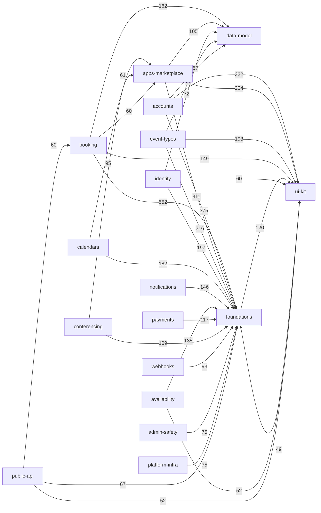
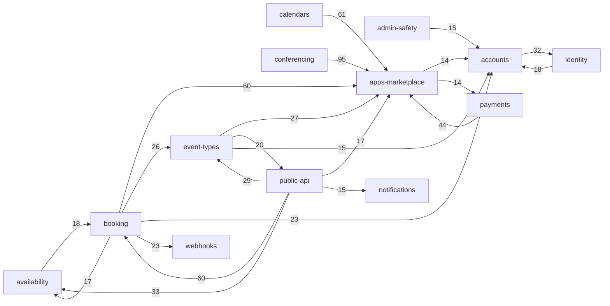

# Evidence: structure

Graph is HEAD-only (0f19cc46ef), i.e. the post-conversion (Cal.diy) tree; there is no pre-conversion graph, so no
signal here is "pre-conversion only". `removed-ee` and `companion` have no graph (history-only). Labels: `evidence` = measured by a command below; `inference` = my reading; `unknown` = blind spot.

## Graph sources

| Language | Source | Level | Confidence | Result |
|---|---|---|---|---|
| TypeScript/JS (only language; 119 package.json roots) | Own import scanner (Python regex over tracked files, `git ls-files`), aliases resolved with `tsconfig.depcruise.json` `paths`, relative imports resolved to files; `import type` / all-`{type X}` specifiers / edges into `.d.ts` => `type`; edges from `scripts/`, `.github`, `deploy` or into `dist/build/.next` => `build` | 4 (universal fallback) | **low-to-medium** (see blind spots) | 4358 production files scanned, 4237 nodes in edges, 16191 file edges: runtime 13544, type 2605, build 42 |

- Level 1 (repo's own tooling): `.dependency-cruiser.cjs` + `tsconfig.depcruise.json` exist but are **untracked** (`git ls-files` = 0) and not referenced by any manifest/turbo/.github file; the layer rules inside it were used as the intended-boundary spec (evidence). `agents/rules/architecture-circular-dependencies.md` says enforcement is "ESLint + CI circular check" (stated intent; not verified).
- Level 2/3: **no `node_modules` directory**, no `depcruise`/`madge`/`skott`/`tsc` on PATH or in `node_modules/.bin`; nothing installed. Fallback used.
- Scope: `apps/web`, `apps/api` (incl. v2), `packages/**`, `example-apps`, root scripts. Excluded: tests/specs/stories/`__mocks__`/`playwright`/`test(s)`/`testing` dirs, `.d.ts` as *sources*, noise per scan.py (generated, snapshots, locales JSON), `packages/prisma/generated`. Prisma `enums`/`generated` imports (319 specs, 244 files import `@calcom/prisma/enums`) are mapped to a virtual node `packages/prisma/enums/index.ts` (data-model) because the generated client is not tracked.
- Counted production files by area: apps/web 838, packages/features 767, packages/app-store 714, apps/api 552, packages/trpc 398, packages/platform 347, packages/lib 236, packages/ui 173, packages/emails 139.
- Unresolved internal specs (not in graph): 154 (94 relative: 72 `../config.json`, CSS, `types` files; 60 alias: 14 `@/components/Navbar` etc. in an example app, `@calcom/trpc/types/server/...` generated, `@calcom/i18n/locales/*/common.json`, `@calcom/embed-react|snippet` package roots). Dynamic `import()`/`require('literal')` ARE counted (394 edges, runtime). Non-literal dynamic specs are NOT.
- Blind spots (`unknown` effect): re-export chains count as an edge to the barrel, not the leaf (inflates barrel Ca, e.g. `packages/ui/components/button/index.ts`); regex parsing, not an AST (multi-line/odd syntax could be missed); `apps/api/v2` consumes `@calcom/platform-libraries` which this graph maps to **source** (`packages/platform/libraries`) whereas runtime consumes a built/published package (whether apps/api/v2 pins the npm build is not verified here); DI containers, tRPC router wiring by string, generated app-store registries (`*.generated.ts`, 24 runtime edges into them), queues/tasker, webhooks, feature flags are invisible.
- Folding: all numbers below use `scan.attribute()` (same as capabilities.tsv). `graph-metrics.mjs --modules` gives a slightly different fold (glob `*` excludes `/`): 34 vs 46 unmapped files; its output was used only as cross-check (Ca/Ce within ±1 of my table; same 22 nodes, one 20-node cycle).
- Attribution caveats at HEAD: 46 production files are `unmapped` (mostly `apps/web/lib` 23, `apps/web/components` 9, `apps/web/pages` 3) and **34 live files are attributed to `removed-ee`** (`packages/trpc/server/routers/loggedInViewer/*` 29 and `publicViewer/*` — notification subscriptions, markNoShow, connectAndJoin, event…; they still exist and are imported: 64 cross-capability edges). Treat `removed-ee` here as a path-pattern artefact, not as deleted code. `unmapped` carries 149 cross-capability edges. Both are excluded from the Mermaid.

## Capability graph

Runtime edges only, folded file edge -> capability. 6413 of 13544 runtime edges cross capabilities; 7131 stay inside one. Ca/Ce = number of distinct *capabilities* in/out; instability = Ce/(Ca+Ce); "in/out edges" = file-level edge counts. `evidence`.

| Capability | Prod files | Ca | Ce | Instab. | in edges | out edges | Files in other caps importing it |
|---|--:|--:|--:|--:|--:|--:|--:|
| foundations | 461 | 19 | 19 | 0.50 | 2760 | 299 | 1307 |
| ui-kit | 230 | 16 | 2 | 0.11 | 1327 | 50 | 471 |
| data-model | 22 | 18 | 1 | 0.05 | 793 | 1 | 601 |
| apps-marketplace | 482 | 14 | 17 | 0.55 | 355 | 704 | 219 |
| booking | 413 | 16 | 19 | 0.54 | 181 | 1147 | 102 |
| identity | 153 | 15 | 13 | 0.46 | 126 | 405 | 105 |
| accounts | 221 | 14 | 15 | 0.52 | 120 | 854 | 95 |
| event-types | 170 | 14 | 16 | 0.53 | 96 | 588 | 70 |
| availability | 145 | 7 | 16 | 0.70 | 89 | 278 | 56 |
| calendars | 177 | 11 | 10 | 0.48 | 67 | 324 | 40 |
| webhooks | 131 | 11 | 11 | 0.50 | 61 | 206 | 38 |
| admin-safety | 161 | 9 | 10 | 0.53 | 59 | 187 | 41 |
| i18n | 2 | 15 | 0 | 0.00 | 56 | 0 | 56 |
| notifications | 159 | 12 | 9 | 0.43 | 51 | 162 | 38 |
| public-api | 907 | 8 | 19 | 0.70 | 49 | 347 | 37 |
| payments | 121 | 7 | 14 | 0.67 | 46 | 254 | 38 |
| embeds | 56 | 9 | 7 | 0.44 | 34 | 38 | 31 |
| platform-infra | 114 | 8 | 17 | 0.68 | 18 | 187 | 16 |
| conferencing | 189 | 5 | 12 | 0.71 | 17 | 277 | 14 |
| docs-planning | 7 | 0 | 0 | - | 0 | 0 | 0 |
| (unmapped / removed-ee, see caveat) | 46 / 34 | 13 / 4 | 9 / 9 | | 97 / 11 | 52 / 53 | |

Only `i18n`, `data-model`, `ui-kit` are stable sinks (instability <= 0.11). `foundations` is a hub with Ca=Ce=19 (instability 0.5): it is depended on by everything *and* reaches into ui-kit (120 edges), data-model (40), identity (19), admin-safety (19), unmapped (15) — it is not a clean bottom layer (`evidence`; `inference`: "foundations" bundles `packages/lib` with shared web components and DI, so it mixes layers).

Top 32 runtime edges (weight = file-level edges), all hubs included:

Domain-only view (hubs foundations / ui-kit / data-model / i18n removed; top 22 of 135 edges) — this is the real domain coupling:

Capability-level mutual (bidirectional) pairs: 73 of 245 cross-capability edges are two-way, strongest: foundations<->ui-kit 120/49, event-types<->public-api 20/29, foundations<->identity 19/197, accounts<->identity 32/18, availability<->booking 18/17, apps-marketplace<->payments 14/44, booking<->payments 12/12, booking<->public-api 14/60, accounts<->apps-marketplace 11/14 (`evidence`). Capabilities are not layered at capability granularity; the layering exists, if at all, at package level (see Broken boundaries).

## Blast radius per capability

"Reach" = transitive set of production files that import it directly or indirectly over runtime edges, across the whole graph (upper bound: barrels and re-exports inflate it; DI invisible). "Contract files" = files of the capability imported by the most files in other capabilities. `evidence` for numbers; `inference` for readings.

| Capability (criticality) | Direct importers (cap: edges) | Reach (files / caps) | Depends on (top) | Contract files (importing files in other caps) |
|---|---|---|---|---|
| booking (high) | public-api 60, availability 18, platform-infra 13, foundations 13, payments 12 (16 caps) | 889 / 17 | foundations 552, data-model 162, ui-kit 149, apps-marketplace 60 | `features/bookings/repositories/BookingRepository.ts` 16, `bookings/Booker/BookerStoreProvider.tsx` 15, `bookings/lib/index.ts` 7 |
| availability (high) | public-api 33, booking 17, foundations 14, accounts 8, event-types 7 | 399 / 11 | foundations 135, ui-kit 52, data-model 36, booking 18 | `apps/web/modules/timezone/components/TimezoneSelect.tsx` 10, `features/schedules/repositories/ScheduleRepository.ts` 6 |
| event-types (high) | public-api 29, booking 26, foundations 15, availability 6 | 717 / 17 | foundations 216, ui-kit 193, data-model 70, apps-marketplace 27 | `features/eventtypes/lib/defaultEvents.ts` 13, `eventtypes/di/EventTypeService.container.ts` 9 |
| calendars (high) | platform-infra 12, public-api 12, apps-marketplace 10, accounts 6, availability 6 | 450 / 13 | foundations 182, apps-marketplace 61, ui-kit 33, data-model 29 | `features/calendars/lib/CalendarManager.ts` 7, `selectedCalendar/repositories/SelectedCalendarRepository.ts` 5 |
| payments (high) | apps-marketplace 14, booking 12, platform-infra 5, public-api 5 | 412 / 12 | foundations 117, apps-marketplace 44, data-model 36 | `app-store/_utils/payments/getPaymentAppData.ts` 11, `stripepayment/lib/utils.ts` 4 |
| identity (high) | accounts 32, foundations 19, booking 12, public-api 11, event-types 10 | 906 / 17 | foundations 197, data-model 72, ui-kit 60, accounts 18 | `features/auth/lib/getServerSession.ts` 44, `membership/repositories/MembershipRepository.ts` 12 |
| public-api (high) | event-types 20, booking 14, calendars 4 (8 caps; it is an entry layer, Ca low) | 681 / 17 | foundations 67, booking 60, ui-kit 52, availability 33 | `platform/atoms/hooks/useIsPlatform.ts` 21 (used inside web UI) |
| platform-infra (high) | booking 6, webhooks 3, payments 2 (8 caps) | 468 / 16 | foundations 75, data-model 24, booking 13, apps-marketplace 13 | `features/tasker/index.ts` 8 |
| data-model (high) | 18 caps; booking 162, apps-marketplace 105, identity 72, event-types 70 | 1951 / 18 | foundations 1 (the only upward edge) | `prisma/index.ts` 376, `prisma/enums/index.ts` (virtual, generated) 244, `prisma/zod-utils.ts` 109 |
| conferencing (medium) | booking 8, apps-marketplace 3, public-api 3 | 340 / 10 | foundations 109, apps-marketplace 95, data-model 33 | `features/conferencing/lib/videoClient.ts` 7 |
| webhooks (medium) | booking 23, identity 9, platform-infra 9 | 635 / 16 | foundations 93, ui-kit 41, data-model 35 | `webhooks/lib/getWebhooks.ts` 11, `sendOrSchedulePayload.ts` 8 |
| apps-marketplace (medium) | conferencing 95, calendars 61, booking 60, payments 44, event-types 27 (14 caps) | 1086 / 17 | foundations 311, ui-kit 204, data-model 105, accounts 14 | `app-store/_utils/getAppKeysFromSlug.ts` 29, `app-store/locations.ts` 27, `_utils/getInstalledAppPath.ts` 25, `_utils/installation.ts` 24 |
| notifications (medium) | public-api 15, booking 14 | 441 / 15 | foundations 146, data-model 6 | `packages/emails/email-manager.ts` 20 |
| embeds (medium) | booking 14, foundations 6, accounts 4 | 489 / 15 | foundations 17, booking 7 | `embed-core/embed-iframe.ts` 22 (+ `embed-core/src/embed-iframe.ts` 6) |
| accounts (medium) | booking 23, identity 18, event-types 15, admin-safety 15, apps-marketplace 14 | 776 / 16 | foundations 375, ui-kit 322, data-model 57, identity 32 | `features/users/repositories/UserRepository.ts` 39, `profile/repositories/ProfileRepository.ts` 15, `modules/shell/Shell.tsx` 11 |
| admin-safety (medium) | foundations 19, identity 13, accounts 9, booking 8 | 741 / 17 | foundations 75, ui-kit 48, data-model 37 | `features/flags/features.repository.ts` 14, `flags/context/provider.ts` 8 |

Reading (`inference`): the dependency "centre of the domain" is `booking` (largest out-degree 1147 edges, 16 dependents including `availability`, `payments`, `platform-infra`, `webhooks` upward) and `apps-marketplace` (fan-in for conferencing, calendars, payments, booking, event-types, i.e. the registry/utility files `_utils/*` and `locations.ts`). Changes in `data-model` (Prisma schema / `zod-utils`), `foundations` (`useLocale` 398 importers, `constants` 316, `logger` 181, `dayjs` 156) and `ui-kit` (`button` 219, `form` 178) reach 1–2k files — mechanically wide but these are stable contracts, not domain logic.

## Cycles

Runtime only; smallest real loop named. `evidence`.

File level: **13 runtime strongly-connected groups** (sizes 8, 6, 5, 4, 4, then eight of 2). No cycle larger than 8 files.

| # | Files | Capabilities | Smallest real loop |
|---|--:|---|---|
| 1 | 8 | embeds, event-types, public-api | `apps/web/modules/embed/components/EventTypeEmbed.tsx` -> `EmbedTabs.tsx` -> `EmbedCodes.tsx` -> `index.ts` -> `platform/atoms/event-types/wrappers/EventTypePlatformWrapper.tsx` -> `EventType.tsx` -> `EventTypeLayout.tsx` (UI loop web<->atoms) |
| 2 | 6 | webhooks | `features/webhooks/lib/tasker/trigger/deliver-webhook.ts` -> `webhook.ts` -> `WebhookProducerService.module.ts` -> `WebhookTasker.module.ts` -> `WebhookTriggerTasker.module.ts` -> `WebhookTriggerTasker.ts` (DI module wiring loop) |
| 3 | 5 | public-api | `platform/types/bookings/2024-08-13/outputs/get-bookings.output.ts` -> `index.ts` barrel chain (barrel loop) |
| 4 | 4 | admin-safety, identity | `watchlist/lib/service/AdminWatchlistOperationsService.ts` -> `features/auth/lib/verifyEmail.ts` -> `watchlist/operations/check-if-email-in-watchlist.controller.ts` -> `watchlist.ts` |
| 5 | 4 | public-api | NestJS `conferencing.controller.ts` <-> `conferencing.service.ts` (+2) |
| 6–13 | 2 each | embeds (`embed-iframe/react-hooks.ts` <-> `embed-iframe.ts`), ui-kit (`MultiOptionInput.tsx` <-> `index.ts`), webhooks (`zapier/api/subscriptions/listOOOEntries.ts` <-> `scheduleTrigger.ts`), booking (`trpc viewer/bookings/get.handler.ts` <-> `features/bookings/lib/getAllUserBookings.ts`), public-api x3 (`endpoint-throttler-decorator.ts` <-> `throttler-guard.ts`; `input.service.ts` <-> `bookings.service.ts`; `outlook.service.ts` <-> `calendars.controller.ts`), event-types (`form-builder/Components.tsx` <-> `FormBuilderField.tsx`) | | |

Capability level: all 20 non-doc nodes form **one strongly connected component** at capability granularity. This is *inflated by two upward file edges*, not 20 mutually dependent domains: `packages/prisma/zod-utils.ts -> packages/lib/zod/eventType.ts` (data-model -> foundations, the only outgoing edge of data-model) and `packages/ui/components/avatar/UserAvatarGroupWithOrg.tsx -> packages/embeds/embed-core/embed-iframe.ts` (ui-kit -> embeds), plus foundations<->ui-kit. Reading: a capability-level "no cycles" rule cannot be adopted as is; the file-level graph is the useful one.

Cycles that exist only with type edges (go to Mechanical signals): including type-only imports, there are 30 file-level groups (largest 35 files, booking 20 / foundations 5 / availability 5 / calendars 4 / apps-marketplace 1) versus 13 runtime ones; 21 of those have no runtime counterpart. Only 5 groups are type-only by themselves (sizes 3,2,2,2,2).

## Broken boundaries

Intended layering (stated in `.dependency-cruiser.cjs` comments and `agents/rules/architecture-circular-dependencies.md`; `inference` that it is the design intent): `packages/lib` (lowest) -> `packages/app-store` -> `packages/features` -> `packages/trpc` -> `apps/web` (top); `platform/types` is foundation; atoms must not import trpc/web. The rules were re-evaluated on the measured edges (`evidence`; runtime / type-only):

| Rule | Violations (runtime / type) | Files | Where |
|---|--:|--:|---|
| lib-not-to-higher-layers | 4 / 0 | 3 | `packages/lib/holidays/HolidayService.ts` and `HolidayServiceCachingProxy.ts` -> `features/holidays/repositories/HolidayRepository.ts`; `packages/lib/hooks/useLocale.ts` -> `apps/web/app/{AppRouter,Custom}I18nProvider.tsx` (**`useLocale` has 398 importers**, so lib -> web is on the hottest path) |
| app-store-not-to-features-or-trpc | **65 / 4** | 43 | `app-store/_utils/payments/*` (11 edges; payments->booking 8, payments->identity 6), `_utils/getCalendar.ts` -> `features/calendar-subscription` (apps-marketplace->calendars 5), `zapier/api/*` (webhooks 7), `_utils/oauth/*`, `googlecalendar/lib` |
| features-not-to-trpc-or-web | 4 / 2 | 5 | `features/bookings/lib/getAllUserBookings.ts`, `services/BookingAttendeesService.ts`, `BookingAttendeesRemoveService.ts`, `di/modules/AvailableSlots.ts` import trpc `viewer/bookings/*.handler.ts` and `viewer/slots/util.ts` |
| atoms-not-to-trpc-or-web / packages-not-to-web | 11 / 6 (atoms) ; 12 / 4 (all packages, excl. testing and app-store pages/components) | 12 ; 10 | `platform/atoms/{event-types,availability,calendar-view,booker,selected-calendars}` -> `apps/web/modules/*` (public-api -> event-types 4, availability 2, calendars 2, accounts 1, booking 1) |
| trpc-not-to-web | 0 / 0 | 0 | clean |
| platform-types-is-foundation | 0 / 0 | 0 | clean |

Hotspots by capability (`evidence`): payments and apps-marketplace (app-store reaching back into features) and public-api (atoms reaching into apps/web) carry nearly all violations; booking has 3 files in features that import trpc handlers (the same `get.handler.ts` <-> `getAllUserBookings.ts` appears as a cycle). The rules exist only as a config file that is untracked and unwired, so the violations (~100 runtime) are consistent with *no enforcement being active*; whether ESLint/CI enforcement exists elsewhere is `unknown` (not searched beyond manifests/.github for depcruise/madge/skott).

Other layering observations: `foundations` -> `ui-kit` 120 edges and `ui-kit` -> `foundations` 49 (shared components live in both); `data-model` -> `foundations` 1 edge; platform-libraries facade `packages/platform/libraries/*` is the only bridge from API v2 into domain code: 143 outgoing edges (booking 30, foundations 19, availability 16, notifications 15, event-types 13, apps-marketplace 10, identity 10, calendars 9).

## Test risks

`inference` from measured edges.
- **apps-marketplace / payments / calendars / conferencing**: reach into generated registries (`*.generated.ts`, 24 edges) and 13–24% of their files import `@calcom/prisma` directly (payments 24%, identity 25%, conferencing 15%, booking 14%). Isolated unit tests need heavy mocking of prisma and the app-store registry; integration with a DB is the realistic level.
- **booking**: 1147 outgoing edges, 552 into foundations, 162 into data-model, 60 into apps-marketplace, 58 files import prisma directly; and it imports apps-marketplace/webhooks/accounts/availability/event-types — the largest mocking surface. Expect integration + e2e (Playwright), not unit isolation.
- **public-api**: 907 files; 182 edges out through `platform/atoms` and 143 through `platform/libraries` into web/domain code. Atoms import `apps/web/modules` (violation rule) so they cannot be tested without the web tree; API v2 modules need Nest DI plus the platform-libraries façade (and prisma only via the façade: 1 file direct).
- **foundations / identity / accounts**: `identity` 25% of files read prisma and `getServerSession` (44 importers) needs a session mock everywhere; `accounts` Shell/UserRepository (39 importers) same.
- **webhooks / platform-infra**: DI-module/tasker wiring loops (cycle #2) mean stubbing needs the whole module chain.
- Low-risk to test in isolation: `i18n`, `ui-kit` (instability 0.11), `data-model` (but `zod-utils.ts` pulls `lib/zod/eventType.ts`).

## Centres and thin entry points

- **Load-bearing contracts (high Ca, low instability)**: `data-model` (0.05; `prisma/index.ts` 376 importers, enums 244), `ui-kit` (0.11; `button` 219, `form` 178, `classNames` 121), `i18n` (0.0; `i18n/server.ts` 50). All three are expected hubs (false-signals rule 2: config/foundation fan-in); change cost is wide but changes are rarely behavioural. `foundations` is a hub with instability 0.50, i.e. both widely used and dependent: `useLocale` (398), `constants` (316), `logger` (181), `dayjs` (156).
- **Domain centres**: `booking` (Ca 16/Ce 19), `apps-marketplace` (Ca 14/Ce 17, the registry feeding conferencing/calendars/payments), `identity` (Ca 15; `getServerSession` 44), `accounts` (`UserRepository` 39, `Shell` 11).
- **Thin entry points / consumers (instability >= 0.67, Ca small)**: `conferencing` (0.71), `availability` (0.70), `public-api` (0.70; wraps booking/availability/event-types through `platform/libraries` — a façade, not core logic), `platform-infra` (0.68; 114 files, only 18 incoming edges), `payments` (0.67). Pure entry candidates (nothing imports them) are not reported because file-level entry points (pages, route handlers, Nest controllers) are scattered across capabilities.
- Config-as-code fan-in to discount (false-signals rule 2): `packages/lib/constants.ts` (316), `prisma/enums/index.ts` (244, generated), `packages/app-store/locations.ts` (27) and app-store `_utils` (24–29 each).

## Mechanical signals

- **Type-only edges: 2605 total (1377 cross-capability)** — kept out of every table above. Largest cross-capability type flows: apps-marketplace->foundations 116, public-api->data-model 112, booking->foundations 99, booking->data-model 81, conferencing->foundations 79, calendars->foundations 62, event-types->data-model 54. 554 of them target `packages/types/*.d.ts` (ambient/`@calcom/types/*` contracts: Calendar 173, Credential 70, App 57, AppHandler 43...). The 17 type-only violations of boundary rules are likewise excluded from the runtime counts.
- **Build edges: 42** (33 cross-capability): `scripts/*` -> `packages/prisma` 15, `packages/app-store` 8, `packages/lib` 5, plus `ui/scripts/*icons*`, `platform/libraries/scripts/*`. Build tooling, not runtime coupling (false-signals rule 1).
- **Type-inflated cycles**: 30 groups with types vs 13 runtime; the 35-file group (booking 20, foundations 5, availability 5, calendars 4) exists only if type imports are counted.
- **Barrel/re-export inflation**: contract-file importer counts for `index.ts` files (prisma 376, ui `button` 219) include re-export hops; cycle #3 is a barrel chain of 5 `index.ts` files.
- **Generated code**: 24 runtime edges into `*.generated.ts` (apps-marketplace 17, payments 3, platform-infra 2, booking 1, conferencing 1) and 244 into the virtual `prisma/enums` node are artefacts of generated/untracked code.
- **Attribution artefacts**: `removed-ee` (34 live trpc viewer files, 64 edges) and `unmapped` (46 files, 149 edges) as described above.

## Unknowns

- `unknown` Real tool graph: dependency-cruiser config exists (untracked) but the tool is not installed; the recommended level-3 tools to install (outside the repo) are **dependency-cruiser** (already configured with aliases + layer rules; would resolve re-exports/barrels properly and honour `tsPreCompilationDeps`) or **skott**/**madge**. The regex scanner can miss multi-line or unusual syntax and cannot see through barrels.
- `unknown` Runtime coupling not in the graph: DI containers (`features/di/*`, `*.module.ts`), tRPC routers composed by name, app-store generated registries (`*.generated.ts`, not tracked), tasker/trigger job queues, webhook delivery, feature flags, Prisma generated client, Next.js file-based routing and server actions, `NestJS` module imports by decorators.
- `unknown` Whether `apps/api/v2` builds `@calcom/platform-libraries` from source or consumes a published package; edges via the façade (143) are drawn to source.
- `unknown` External consumers: npm-published packages (`@calcom/atoms`, `platform-libraries`, embed packages), example-apps, third-party embed hosts.
- `unknown` Whether ESLint/CI enforce the layer rules (the config is untracked; only manifests, turbo and .github were checked for depcruise/madge/skott/circular scripts).
- `unknown` Forge: `gh` unavailable; PRs/reviews/CI status for boundary-breaking changes are not in this file.
- Languages without a graph: none besides TS/JS (JSON/Prisma schema/YAML not modelled; Prisma models and migrations relate capabilities only through the data-model hub).
- Confidence: edge list **medium-low** (regex, fallback level 4, 154 specs unresolved of ~20k internal); capability folding **medium** (46 unmapped + 34 mis-attributed removed-ee files); cycle and boundary findings **medium**; blast-radius reach numbers **upper bounds** (barrels).

## Commands run

- `git -c core.quotepath=off ls-files`; `ls node_modules/.bin`, `where depcruise madge skott`, `grep` of manifests/.github for depcruise/madge/skott.
- Python (eval) import scanner over tracked TS/JS files with `tsconfig.depcruise.json` aliases -> `context/map/.work/edges-ts.csv` (from,to,kind); fold via `scan.attribute()`; Tarjan SCC, BFS shortest cycle, reverse reachability, rule re-evaluation from `.dependency-cruiser.cjs` regexes.
- `node .claude/skills/10x-repo-map/scripts/graph-metrics.mjs context/map/.work/edges-ts.csv --modules context/map/.work/capabilities.tsv --kind runtime --unmapped group [--top 25 | --emit mermaid]` (cross-check; Mermaid raw in `.work/cap-graph-ts.mmd`).
