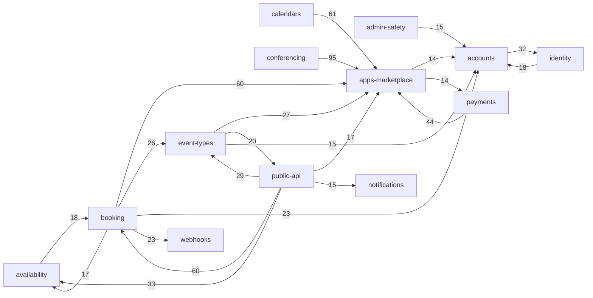

# Project Map — Cal.diy

## TL;DR

Cal.diy is a self-hosted, MIT-licensed scheduling platform, the Cal.com fork with all enterprise code removed. Hosts publish **event types** and **availability**, connect **calendars**, and bookers pick a slot on a public page or embed. The **booking** engine then creates the booking, takes payment, makes a video link, sends email and fires webhooks. A NestJS **API v2** with React **Atoms** and a 150-app **marketplace** surround that core. Most of the 12-month window is Cal.com-era history: on 2026-04-15 commit `ab21c7f8` deleted about 2,800 files (teams, orgs, billing, workflows, insights, routing forms). Activity fell from about 320 to about 12 commits per 30 days, 72% of them `fix:`, so the repo is in **maintenance mode**. Within the live code, the buzz concentrates in **booking** and the **public API / Atoms** layer. Both sit on hand-kept twin copies of the same domain logic (web Booker, Atoms Booker, API v2), and git cannot show when one twin drifts.

Domain-only runtime coupling (hubs `foundations`, `ui-kit`, `data-model`, `i18n` removed; top 22 of 135 edges; weight = file-level import edges; source: `evidence/3-structure.md` lines 108-145):

## Terrain

Buzz families (H/M/L, relative across live capabilities): **C**hange, **F**ix pressure, **Fr**iction, **A**ttention (planning + debt markers), **R**each. Friction from git only (reverts, repeat attempts); human review, closed-unmerged PRs and open bugs are `unknown` without a forge. Trend: whole-window quarters, then post-conversion rate per 30 days.

| Capability | What it does | Crit. (criteria) | Buzz | Trend | Where it lives |
|---|---|---|---|---|---|
| **booking** | create, reschedule, cancel, seat, audit bookings; public booker; bookings dashboard | **high** (data written, core value, public entry, others depend on it) | C **H** · F M (48% broad, but median by strict share) · Fr M · A M-H (74 markers, 1 spec) · R **H** (Ce 19, reach 889 files / 17 caps) | constant; 2.9/30d post, busiest survivor | `packages/features/bookings`, `booking-audit`; `apps/web/modules/bookings`; trpc `viewer/bookings`; `apps/web/app/(booking-page-wrapper)` |
| **public-api** | API v2 (NestJS) + `@calcom/atoms` React components | **high** (public exposure, external consumers, API auth) | C **H** (about 16% of commits are version-bump lockstep) · F M (41%) · Fr M · A L (0.09/1k, diluted) · R **H** (cycles + boundary breaks) | rising pre, 1.8/30d post | `apps/api/v2/src/{platform,modules}`, `packages/platform/{atoms,libraries,types}` |
| event-types | event type config, hosts, private links, booking questions | **high** (data, core value, booking and slots depend on it) | C M · F M (46%) · Fr L · A L-M · R **H** (717 files / 17 caps) | constant | `packages/features/eventtypes`, `apps/web/modules/event-types`, trpc `viewer/eventTypes` |
| availability | schedules, OOO, holidays, slots, troubleshooter | **high** (core value, booking depends on it) | C M · F M · Fr L · A M (0.88/1k) · R M | constant, near-silent post | `packages/features/{availability,schedules,slots}`, trpc `viewer/{availability,slots}` |
| calendars | Google/Outlook/CalDAV connect, selected + destination calendars, cache, subscriptions | **high** (external integrations, credentials, availability depends on it) | C M · F L (38%) · Fr M (freebusy batching revert, no re-land seen) · A M · R M | fading post | `packages/features/{calendars,calendar-subscription,selectedCalendar}`, `packages/app-store/*calendar*` |
| payments | Stripe/PayPal/HitPay/Alby/BTCPay, payment step in booking, credits | **high** (money, webhooks) | C L · F M (47%, n=53) · Fr L · A M (0.90/1k) · R M | thin post | `packages/app-store/{stripepayment,paypal,hitpay,…}`, `app-store/_utils/payments`, `bookings/lib/payment` |
| identity | NextAuth sign-in, signup, OAuth provider, API keys | **high** (identity/access, public entry) | C M · F M · Fr M (spillover-heavy) · A M · R **H** (`getServerSession` 44 importers) | silent after Jun | `packages/features/{auth,oauth}`, `apps/web/app/(use-page-wrapper)/auth`, trpc `viewer/{auth,apiKeys,oAuth}` |
| data-model | Prisma schema, migrations | **high** (data, everything depends on it) | C L · F L (20%) · Fr L · A M (1.21/1k, 14 markers) · R H (stable contract, see Looks hot) | fading | `packages/prisma` |
| apps-marketplace | app registry, install flow, credentials, CRM/analytics apps | medium (external integrations, credentials, runtime fan-in) | C M-H · F M · Fr **H** (7 real reverts) · A **H** (1.20/1k, 54 markers) · R **H** (1086 files / 17 caps) | constant, fading | `packages/app-store` (151 dirs), `app-store-cli`, `apps/web/modules/apps` |
| conferencing | Cal Video + 30 video/chat apps | medium | C L · F M (52%, n=44) · Fr L · A M · R L-M | silent | `packages/app-store/*video*`, `features/conferencing`, `apps/web/modules/videos` |
| webhooks | outbound webhook subscriptions, Zapier/Make/n8n | medium | C L · F L · Fr M (payload contract revert) · A L · R M-H (635 files / 16 caps) | silent after Jun | `packages/features/webhooks`, `apps/web/modules/webhooks`, trpc `viewer/webhook` |
| accounts | profile, settings, onboarding, app shell | medium | C **H** · F M · Fr H raw (UI-polish reverts, mechanical) · A L · R **H** (`UserRepository` 39 importers) | campaign Nov-Jan, constant | `apps/web/modules/{settings,onboarding,shell,users}`, `packages/features/{users,profile}` |
| embeds | embed snippet/iframe core | medium (public exposure on third-party sites) | C L · F **H** (52%, n=40) · Fr L-M · A **H** (2.34/1k, 42 markers) · R M (8-file cycle) | silent | `packages/embeds`, `apps/web/modules/embed` |
| notifications | email, SMS, push, short links | medium | C L · F M · Fr L · A L · R M | thin | `packages/emails`, `packages/sms` |
| admin-safety | admin pages, blocklist/watchlist, bot detection, flags | medium | C M (peaked Jan, then dead) · F L · Fr L · A L · R M | dead post (1 commit) | `packages/features/{flags,feature-opt-in,watchlist}`, `apps/web/app/…/settings/(admin-layout)` |

Other lines:
- **Platform & infrastructure** (`platform-infra`, criticality high: pipeline and jobs can break production): 477 commits, the most of any area; 72 of 165 fixes are CI/release iteration. Contains `.github`, root configs, `tasker` (background jobs), cron routes. Faded to 0 commits after June.
- **Shared foundations** (`foundations`: `packages/lib`, `types`, `testing`, `features/di`, `data-table`): hub with Ca=Ce=19. `useLocale` has 398 importers, `constants` 316, `logger` 181. It reaches back into `ui-kit` (120 edges), so it is not a clean bottom layer. **Design system** (`ui-kit`, `packages/ui`, `coss-ui`) has the highest broad fix share (60%), mostly UI polish. **Localisation** (`i18n`) is the stable sink (instability 0.0).
- **Docs & planning**: README, `agents/` (45 rules, 56 skill files), `specs/` (1 live spec). 87% of its changes are Markdown.
- **Removed at HEAD, history only, never ranked**: `removed-ee` (13.8% of window changes, deleted 2026-04-15) and `companion` (8.3%, Expo + Chrome app moved to `calcom/companion` on 2026-02-16).

**Folder structure vs capabilities.**
- One capability spans many folders. Booking lives in at least 6 places: `packages/features/bookings`, `apps/web/modules/bookings`, trpc `viewer/bookings`, `apps/web/app/(booking-page-wrapper)`, `apps/api/v2/src/platform/bookings` and `packages/platform/atoms/booker`.
- One folder serves several capabilities. `packages/app-store` holds calendars, video, payments, webhooks/automation, CRM and analytics under one registry. `packages/features` and `apps/web/modules` mix every capability. `packages/trpc/server/routers/viewer` is one folder per capability.
- API v2 is organised by endpoint, not by capability, so a capability's HTTP surface is not where its logic is.

**Coverage.** 13,322 counted non-noise file changes. Unmapped 0.9% (115). Catch-all buckets (platform-infra 7.4%, foundations 5.7%, docs 4.7%, ui-kit 2.4%, i18n 2.6%, data-model 1.2%) total about 24%, under the 40% limit. 22.1% of changes belong to the two removed capabilities. 1,870 of 1,982 commits are counted (25 bot, 11 mass incl. `ab21c7f8`, 76 bump-only excluded; 16 Devin-authored kept as activity).

## Real couplings

Source tags: **graph** = runtime import edge (HEAD tree), **co-change** = commits touching both (≤3 capabilities only, pre-conversion dominated), **contract** = hand-kept shared shape. Mechanical = cheap, guarded or lockstep by workflow.

| Coupling | Source | Strength | Real or mechanical |
|---|---|---|---|
| **booking core ↔ API v2 / Atoms Booker twins** | graph: `public-api → booking` 60 edges, `booking → public-api` 14, through the `packages/platform/libraries` façade (143 outgoing edges). Co-change: 22 commits, confidence 0.10 (`1-history.md:179`) | high structural, **low co-change** | **real**. A booking change without its twin cannot be seen in history, `unknown` |
| **apps-marketplace as fan-in registry** | graph: conferencing→ 95, calendars→ 61, booking→ 60, payments→ 44, event-types→ 27. Contract files `_utils/getAppKeysFromSlug.ts` (29 importers), `locations.ts` (27) | high | partly mechanical (registry fan-in by design, rule 2); no build guard seen |
| **app-store reaches back into features/trpc** | graph: 65 runtime boundary violations in 43 files (`_utils/payments/*`, `_utils/getCalendar.ts` → `calendar-subscription`, zapier). Stated rule is in an untracked, unwired `.dependency-cruiser.cjs` | high | **real**; enforcement `unknown` |
| web ↔ atoms UI loop | graph: 8-file runtime cycle `EventTypeEmbed.tsx → … → EventTypePlatformWrapper.tsx → … → EventTypeLayout.tsx`; 11 runtime `atoms → apps/web/modules` imports | medium | **real** (embeds, event-types, public-api) |
| booking ↔ availability, booking ↔ event-types, booking → webhooks / accounts | graph: 18/17, 26, 23/23. Co-change booking–event-types 49 (0.32) | medium | real; booking-event-types co-change is partly feature sweeps |
| apps-marketplace ↔ payments (mutual) | graph 14 ↔ 44; payments → booking 8, → identity 6 through `_utils/payments` | medium | real, the same boundary breach as above |
| accounts ↔ identity | graph 32 / 18; co-change 16 (0.23) | medium | real (onboarding/user/membership); partly the deleted team flow |
| foundations ↔ ui-kit; data-model → foundations | graph 120 / 49; one edge `prisma/zod-utils.ts → lib/zod/eventType.ts` | high | mixed layers. These two upward edges make all 20 capabilities one strongly connected group, an artefact |
| `schema.prisma` ↔ migrations, `locales/en` ↔ UI, version bumps (platform-infra–public-api 52), `openapi.json` ↔ API (docs–public-api 43) | co-change | high | **mechanical** (workflow lockstep; `openapi.json` is deleted at HEAD, drift guard `unknown`) |
| `schema.prisma` ↔ API v2 DTOs / `platform/types` inputs | none visible | n/a | `unknown`, a hand-kept contract with no measured guard |
| public contracts (API v2, Atoms, `platform-libraries`, embed packages) ↔ their consumers | none in repo | n/a | `unknown (external)` |

DI containers, tRPC router wiring by name, tasker queues, `*.generated.ts` app registries and the Prisma client are not in the graph, so coupling through them is `unknown`.

## Risk zones

Two capabilities qualify. The bar is high criticality plus high buzz in at least two independent families.

### 1. Booking (core and its twins)
- **Why**: the product's money-and-data path, with the widest outgoing coupling in the repo and the largest hand-kept twin surface.
- **Independent signals**:
  - *Change*: 1,518 changes and 361 commits, the highest in the repo. 18 post-conversion commits keep it the most active survivor (`1-history.md:17,78`).
  - *Reach*: Ce 19, 1,147 out-edges, reach 889 files / 17 capabilities, 58 files import `@calcom/prisma` directly. A runtime cycle `trpc viewer/bookings/get.handler.ts ↔ features/bookings/lib/getAllUserBookings.ts` and three `features → trpc` boundary violations (`3-structure.md:31,155,187,201`).
  - *Attention*: 74 TODO-type markers, the most of any capability, and the only capability with a spec (`cancellation-reason-requirement`) (`2-discussion.md:14,56`).
  - *Fix pressure* (supporting only): 172 fix commits, 48% broad. Its strict share (44%) is at the repo median, so this mostly reflects volume (`1-history.md:112`).
  - *Friction* (supporting): the genuine reversal `1f102bf3` (bookings redesign, 2025-11-14) and no revert after conversion (`1-history.md:144`).
- **Mechanical discount**: 142 of 361 commits are wide (>3 capabilities) because of structural moves. Cross-cutting commits are counted once per capability, so change is overstated by about a third at most.
- **Files**: `packages/features/bookings/lib/service/RegularBookingService.ts` (44 touches), `.../repositories/BookingRepository.ts` (32; 16 importing files in other capabilities), `.../lib/handleCancelBooking.ts` (23), `packages/trpc/server/routers/viewer/bookings/`, `apps/web/modules/bookings/views/bookings-single-view.tsx` (23).
- **Caution before a bigger change**: any change here also needs the matching change in `apps/api/v2/src/platform/bookings` and `packages/platform/atoms/booker`. Nothing links them mechanically.

### 2. Public API v2 and Atoms
- **Why**: public, externally consumed surface that mirrors most of the domain through a façade, with boundary breaks and real cycles.
- **Independent signals**:
  - *Change*: 1,397 changes and 329 commits. About 52 commits are version-bump lockstep (mechanical), and the rest is controller/service work (`1-history.md:18,176`).
  - *Reach*: 143 edges into the domain through `packages/platform/libraries/index.ts` (20 touches). 11 runtime `atoms → apps/web/modules` boundary violations. Four more cycles inside NestJS and platform types (`3-structure.md:182-186,202,208`).
  - *Friction* (supporting): 3 revert/re-land pairs traced to it before the conversion (`USE_POOL`, event-types for non-org users, release v6.1.6) (`2-discussion.md:42`). `51b3f5c7`, the largest revert, was about Atoms (`1-history.md:142`).
- **Files**: `packages/platform/libraries/index.ts`, `apps/api/v2/src/platform/bookings/2024-08-13/` (moved from `src/ee/` in `ab21c7f8`), `packages/platform/atoms/booker/BookerPlatformWrapper.tsx`, `apps/web/modules/embed/components/EventTypeEmbed.tsx`.
- **Caution**: the API/Atoms consumers live outside this repo (`unknown (external)`). It is also `unknown` whether `apps/api/v2` builds `platform-libraries` from source or pins a published build, so a change may not reach the API when expected.

### Watch (missed the bar narrowly)
- **identity** (high): reach is high (`getServerSession` 44 importers, 906 files), and 25% of its files read Prisma directly. But change, fix and friction are only medium, and it has been silent since June. A critical capability nobody discusses (0 plans). Files: `packages/features/auth/lib/getServerSession.ts`, `next-auth-options.ts`.
- **event-types** (high): reach is high (717 files, `defaultEvents.ts` 13 importers). Fix share is 46% on small deltas. Twin with API v2 event-type inputs is `unknown`.
- **apps-marketplace** (medium): reverts (7 real), debt (1.20/1k) and reach are all high. But reach is partly registry fan-in (rule 2), and the two analytics-schema reverts share one cause. It misses the "three independent" bar.
- **calendars + payments** (high, small post volume): the `app-store/_utils/getCalendar.ts ↔ calendar-subscription` seam co-changes for real (9 commits). The 65 upward imports are concentrated in `_utils/payments`. The freebusy-batching revert (2025-12-24) has no re-land by subject.
- **embeds** (medium): debt density is the highest (2.34/1k, `embed.ts` 10, `embed-iframe.ts` 6), fix share 52% on n=40, and a real 8-file cycle. It misses on reach (medium).
- **data-model** (high): the widest contract (`prisma/index.ts` 376 importers) and a hand-kept pair with API v2 DTOs, but low change and low fix share. It is a stable contract, not a hot area.

### Looks hot, is not
- **platform-infra**: 477 commits and 72 CI/release fixes with a 19% clean-fix ratio. Pipeline iteration plus a catch-all footprint (`apps/web/package.json`), with one owner (Keith Williams) whose share is 2.9× his team-wide share. Shared cause counted once; the owner left in April.
- **ui-kit** (60% fix) and **i18n** (63 fixes): UI polish and locale completion (rules 5, 8).
- **accounts**: 10 raw reverts are UI-shell polish iterations (sticky navbar, fixed header) plus a team-creation flow that was reverted, re-landed and later deleted. Change comes from the onboarding-v2 campaign, a shared cause.
- **Co-change corridors**: platform-infra–public-api, docs–public-api (`openapi.json`), accounts–i18n are workflow lockstep.
- **Capability-level "one big cycle"**: inflated by two upward edges. File level has 13 runtime cycles, the largest 8 files. Type-only imports inflate it to 30 groups (largest 35 files).
- **Revert spillover**: `51b3f5c7` (108 files, 12 capabilities) and `a4d46263` (74 files, 13) inflate revert counts of booking, foundations, embeds and others.
- **Agent trailers**: about 35% of counted commits carry an AI co-author trailer. It says how code is written, not where it is fragile.
- **Deleted history**: `removed-ee` and `companion` are 22% of window volume and are gone at HEAD. 25 of 81 hot files checked were deleted or moved.

## Whom to ask

Baseline: 183 distinct humans in the window, but **59 after the conversion, 47 of them with exactly one commit**. The window's prolific owners stopped between February and April 2026, and `.github/CODEOWNERS` is empty (1 byte), so there is no formal ownership. Concentration findings describe people no longer visible in the repo, so treat them as "read their PRs", not as a bus factor.

| Zone | Window history (topic match, last commit) | Still visible after conversion |
|---|---|---|
| booking | Anik Dhabal Babu (13%, `features/bookings`, e2e; 2026-03-10), Hariom Balhara (`booking-audit`; 2026-03-19), Eunjae Lee (bookings UI modules; 2026-03-12) | Anirban Singha (4 booking commits, last 2026-08-08), Romit (6, last 2026-05-05) |
| public-api | Morgan (17%, 333 file changes in `apps/api/v2/src`; 2026-03-13), Rajiv Sahal (2026-03-18), Alex van Andel (2026-03-24) | no one with more than 2 commits (Pranavvv 2) |
| identity (watch) | Pedro Castro (`features/auth`, 25 file changes; 2026-04-16), sean-brydon (2026-02-23) | Romit 3, Anirban Singha 2 |
| event-types, availability (watch) | Benny Joo (13% / 18%; 2026-04-15) | Romit 4, Anirban Singha 2 |
| apps-marketplace, calendars (watch) | Joe Au-Yeung (salesforce, routing; 2026-03-09), Volnei Munhoz (`calendar-subscription`, app-store `_utils`; 2026-02-26) | Anirban Singha 3 |
| embeds (watch) | Hariom Balhara (25%), Volnei Munhoz (20%) | none with more than 1 commit |

Concentration is real in window data for admin-safety (Eunjae Lee 39%), webhooks (Syed Ali Shahbaz 23%), embeds (Hariom Balhara 25%), accounts (sean-brydon 20%). None of them has a post-conversion commit. For how the removal was done, ask Romit (20 cleanup commits, last 2026-05-05) and Anirban Singha (10, last 2026-08-08).

## First day

Entry file first, then where the logic lives. Entry-to-logic links marked `inference` were not traced by a command.

1. **Booking logic**: `packages/features/bookings/lib/service/RegularBookingService.ts` (most-touched file in the top capability) with `.../lib/handleCancelBooking.ts` and `.../repositories/BookingRepository.ts`. Entry routes (`inference`): `apps/web/pages/api/book/event.ts`, `apps/web/app/(booking-page-wrapper)/[user]/[type]/page.tsx`. Booker UI in `packages/features/bookings/Booker/`.
2. **Booking management**: `packages/trpc/server/routers/viewer/bookings/_router.tsx` and `apps/web/modules/bookings/views/bookings-single-view.tsx`.
3. **The twin seam**: `packages/platform/libraries/index.ts` (façade from API v2 into domain, 143 edges), then `apps/api/v2/src/platform/bookings/2024-08-13/` and `packages/platform/atoms/booker/BookerPlatformWrapper.tsx`. Read these side by side with item 1.
4. **Data contract**: `packages/prisma/schema.prisma` (23 touches; most cross-capability co-change hub).
5. **Marketplace registry**: `packages/app-store/_utils/getCalendar.ts` and `packages/app-store/locations.ts` (27 importers). Calendar logic: `packages/features/calendars/`, `packages/features/calendar-subscription/`.
6. **Event types and slots**: `packages/features/eventtypes/repositories/eventTypeRepository.ts` and `packages/trpc/server/routers/viewer/slots/util.ts` (slot computation helper), `packages/features/schedules/`.
7. **Identity**: `packages/features/auth/lib/getServerSession.ts` (44 importers) and `packages/features/auth/lib/next-auth-options.ts`.
8. **Intent of the architecture**: `agents/rules/architecture-vertical-slices.md` and its siblings in `agents/rules/`. They are stated rules; the enforcement config is untracked, so verify against code. Background jobs entry: `packages/features/tasker/tasker.ts`.

## Limitations

- **Window and epoch.** 2025-10-26..2026-10-19. About 93% of counted commits (1,766 of 1,870) precede the Cal.diy conversion, so whole-window rankings describe Cal.com-era work. The post-conversion epoch has 104 counted commits, at most 45 file changes per capability. Post-epoch ranks and shares are anecdotal. Post-epoch co-change is not measurable (only accounts–identity reaches support 3).
- **Sources.** Git only. `gh` is not installed, so human review activity, closed-unmerged PRs, PR size and latency, issues, open bugs and labels are `unknown`, not zero. The "Friction" column rests on reverts and repeated subjects. `.github/CODEOWNERS` is empty.
- **Graph coverage.** TypeScript/JS only, from a regex import scanner (4,358 production files, 16,191 edges: 13,544 runtime, 2,605 type-only, 42 build). Confidence low-to-medium. 154 internal specs unresolved. Re-export chains count as an edge to the barrel. Blast-radius numbers are upper bounds. DI containers, tRPC routers, tasker queues, generated app-store registries and the Prisma client are invisible. HEAD tree only: `removed-ee` and `companion` have no graph. `depcruise`, `madge` and `tsc` are not installed (no `node_modules`), nothing was installed.
- **Capability coverage.** Unmapped 0.9% of changes, 72 files at HEAD. The attribution is inferred from paths, so the weakest figures are the catch-alls (platform-infra, foundations, docs). Known artefact: about 34 live files under `packages/trpc/server/routers/loggedInViewer` and `publicViewer` are attributed to `removed-ee`. They still exist and are imported (64 edges). Their history is therefore counted in the removed block, not in a live capability. 46 production files are unmapped in the graph.
- **Agents.** All four evidence agents completed and none failed. The history, discussion and people files carry no gaps beyond the forge-only ones above.
- **What the map does not say.** Where production errors happen (Sentry is in use, not visible from git). Whether silence in webhooks, identity, availability, calendars, conferencing and admin-safety since June means stable or abandoned. Why activity fell 70% from February to March, before the conversion. Who maintains Cal.diy now.
- **Unknowns worth a focused investigation.**
  1. Drift between booking core, the Atoms Booker and API v2 bookings (co-change confidence only 0.10), and the guard on `schema.prisma` ↔ API v2 DTOs.
  2. Whether `apps/api/v2` consumes `platform-libraries` from source or from a published build, and who consumes the published packages (`unknown (external)`).
  3. Whether anything enforces the layer rules now (the dependency-cruiser config is untracked and unwired). 65 app-store → features and 11 atoms → web runtime violations exist.
  4. Whether a drift guard exists for the API spec now that `docs/` is deleted (`openapi.json` is gone from HEAD).
  5. The content of the same-day double revert `227ed64b` / `f5a813f5` (2026-02-13), which touches data-model, identity and accounts.
  6. Real graph via dependency-cruiser (already configured, not installed) and issue/PR data via `gh`.
