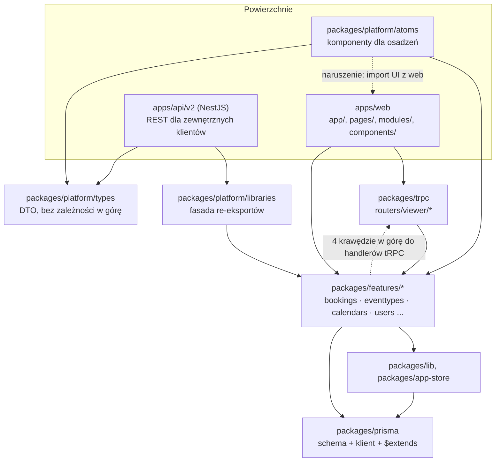

# Mapa repo cal.diy — onboarding

Syntetyzuje trzy artefakty (nie powtarza ich tabel; liczby i ich pochodzenie są tam):
`artifact-1-territory.md` (historia gita) · `artifact-2-structure.md` (graf importów, dependency-cruiser) · `artifact-3-contributors.md` (ludzie).
Okno danych: **2025-10-25 → 2026-10-19**. To mapa aktywności i struktury z jednego roku, nie ocena jakości — patrz sekcja 7.

## 1. TL;DR

cal.diy to fork Cal.com (od 2026-04-15, EE usunięte): monorepo Yarn/Turbo z aplikacją Next.js (`apps/web`), publicznym REST API (`apps/api/v2`, NestJS) i wspólnymi pakietami (`packages/*`). To system do **umawiania spotkań**, więc dominuje jedna domena — rezerwacje — rozlana na cztery warstwy (rdzeń, tRPC, API v2, UI); cztery z dziesięciu najaktywniejszych modułów to właśnie ona. Praca skupia się w `packages/features/bookings` (163 commity, #1) i jego satelitach. Aktywność spadła ~10× po marcu 2026 (583 commity w Q1 → 59 w Q2 → 26 w Q3); po kwietniu są to głównie pojedyncze poprawki od społeczności. Boli w trzech miejscach: rdzeń rezerwacji jest wielki (2690 linii w jednym serwisie) i wszędzie importowany, warstwa API/platform nie ma testów jednostkowych ani aktywnych opiekunów, a wiedza o większości obszarów jest u ludzi, którzy nie commitowali od lutego–marca 2026. Reszta „groźnie wyglądających" plików (schemat bazy, tłumaczenia, `openapi.json`, testy E2E) jest głośna z powodów procesowych — lista w sekcji 4.

Czytanie: ciągłe = import z grafu (artefakt 2); przerywane = krawędzie sprzeczne z regułami warstw.

## 2. Teren

**Duża odpowiedzialność (centrum):** rezerwacje w czterech warstwach — `packages/features/bookings` (rdzeń: tworzenie, anulowanie, potwierdzanie, seats), `packages/trpc/server/routers/viewer/bookings`, `apps/api/v2/src/platform/bookings` i UI w `apps/web/modules/bookings` (+ `apps/web/components/booking`). Drugi biegun to `packages/features/eventtypes` / `apps/web/modules/event-types`. `packages/prisma` i `apps/web/playwright` są wysoko w rankingu commitów, ale z innych powodów niż domena (sekcja 4).

**Peryferia:** `apps/docs`, `app-store/*` (integracje; część plików `*.generated.*`), `features/flags`, `features/tasker`, `features/booking-audit`. Katalogi uśpione od marca–kwietnia 2026: `flags`, `tasker`, `booking-audit`, `platform/libraries`, `api/v2/lib/*` — dają jeszcze sprzężenia w historii, ale nikt ich dziś nie rusza. Zniknęły: `features/ee`, `modules/ee`, `api/v2/src/ee/*`, `apps/companion`.

**Głębokie vs płytkie:**

| | Moduły | Dlaczego |
|---|---|---|
| Głębokie (duże zamknięcie importów, dużo ukrytej pracy) | `features/bookings` (zamknięcie: mediana 22, max 925), `api/v2/platform/bookings` (max 1192), `platform/libraries` (mediana 269), `modules/event-types` (mediana 150) | mała zmiana w jednym pliku ciągnie setki plików runtime |
| Płytkie (mały zasięg) | `packages/prisma` (max 17), `platform/types` (mediana 4), `trpc/bookings` (mediana 3, ale p90 738 — rozkład dwugarbny: lekkie handlery obok ciężkich) | proste w środku, ale `platform/types` ma duży *fan-in* (API v2: 141 plików, atomy: 64), a `prisma` dotyka 47 modułów |

**Aktywność w czasie:** szczyt Q1'26 (styczeń: 338 commitów z konwergencji kampanii — webhooks, audit log, OAuth 2.0, billing, Tasker, flagi; ok. 54% commitów z udziałem agenta AI). Od maja 5–18 autorów miesięcznie, w październiku 3 autorów. Udział w aktywności: `features/bookings` stały (~13%); `modules/bookings`, `onboarding`, `shell`, `prisma` wygasają; `api/v2/platform/bookings` ma 0 commitów od marca. Q3 jest w 77% poprawkami (`fix:`).

## 3. Realne powiązania

Skąd wiem: **[git]** = współzmiany commitów (artefakt 1), **[graf]** = import dependency-cruiser (artefakt 2), **[unknown]** = narzędzie tej relacji nie widzi.

### Co zmienia się razem — ręczna edycja

| Para | Siła | Źródło | Uwagi |
|---|---|---|---|
| `features/bookings` ↔ `trpc/viewer/bookings` | 23 commity, 53% | [git] + [graf] | tRPC wchodzi do rdzenia bezpośrednio (`BookingRepository`, `BookingAccessService`, `handleCancelBooking`); rdzeń importuje handlery z powrotem — cykl runtime `getAllUserBookings.ts` ↔ `get.handler.ts` |
| `features/bookings` ↔ `api/v2/platform/bookings` | 17, 37% | [git]; [graf]: **0 importów bezpośrednich** | API v2 wchodzi tylko przez `platform/libraries` — sprzężenie jest pośrednie, przez fasadę |
| `features/bookings` ↔ `platform/libraries` | 13, 48% | [git] + [graf] (91 krawędzi do `features`) | patrz „fasada" niżej |
| `api/v2/platform/bookings` ↔ `platform/types/bookings` | 13, 81% | [git] + [graf] | DTO kontraktu; zmiana wyjścia API = zmiana typu. Najsilniejsze sprzężenie w repo |
| `features/bookings` ↔ `booking-audit` | 11, 48% | [git]; [graf]: brak cykli | `booking-audit` uśpiony od marca |
| `features/bookings` ↔ `features/users` | 10, 37% | [git] | wspólny `UserRepository` (36 modułów partnerskich) |
| `features/bookings` ↔ `prisma` | 18, 27% | [git]; relacja na poziomie pól modelu: **[unknown]** | graf widzi import `@calcom/prisma`, nie widzi, które modele/pola kod czyta |
| `features/bookings` ↔ `modules/bookings` | 14, 18% | [git] + [graf] (0 cykli) | UI jest luźno związany z rdzeniem; najbliższy partner to `components/booking` (30%) |
| `apps/web/playwright` ↔ reszta | ≤ 20% z dowolnym partnerem (po korekcie na usunięte pliki) | [git]; **[unknown]** w grafie | testy E2E nie importują aplikacji, graf tego powiązania nie ma; dane nie rozstrzygają, czy to brak testów, czy osobne PR-y |

**Trójka rdzeń + tRPC + API v2:** tylko 6 commitów (14%). Zmiana rdzenia zwykle nie jest przepisywana we wszystkich powierzchniach naraz — co może znaczyć rozjazd zachowania, nie oszczędność.

### Co zmienia się razem — przez regenerację, mock albo rutynę procesu (tańsze)

| Pliki | Mechanizm | Wniosek |
|---|---|---|
| `docs/api-reference/v2/openapi.json` (43 commity, 35 modułów) | generator `yarn generate-swagger`, commitowany ręcznie | w `.github` brak kroku, który go regeneruje lub sprawdza → ryzyko dryfu, nie ryzyko hotspotu |
| `app-store/*.generated.*` (11 plików) | generowane przez app-store-cli; nie edytować ręcznie | zmiana przez regenerację |
| `payment.services.generated`, `calendar.services.generated`, `video.adapters.generated`, `crm.apps.generated` w testach | globalnie mockowane w `packages/testing/src/setupVitest.ts` i `bookingScenario.ts` | wspólny wzorzec to konfiguracja testów, nie sprzężenie domeny; testy tych modułów nie dotykają prawdziwych adapterów |
| `packages/i18n/locales/en/common.json` (142 commity, 116 modułów) | reguła repo: każdy napis UI trafia do tego pliku | proces, nie sprzężenie |
| `yarn.lock` (64 commity, 44 moduły) | narzędzie po ręcznej zmianie zależności | proces |
| `packages/prisma/schema.prisma` + migracje SQL | 60/64 commitów schema ma migrację w parze | proces; `zod/` i `enums/` są w `.gitignore` (generowane po `yarn prisma generate`) |

### Warstwy i cykle

- **Reguły warstw** (`.dependency-cruiser.cjs`): 101 par naruszeń, **identyczne z baselinem** (0 nowych) — dług jest znany i nie rośnie. Największy skupiony w `app-store → features/bookings` (14 par, 7 plików) i `atoms → apps/web/modules/bookings` (np. `BookerPlatformWrapper.tsx` → `Booker.tsx`).
- **Luki reguł — narzędzie ich nie pilnuje:** `packages/lib/hooks/useLocale.ts` (424 importerów) importuje z `apps/web/app` (najniższa warstwa → najwyższa); 8 krawędzi `lib`/`app-store`/`features` → `platform/atoms/hooks` (`useIsPlatform`); 3 testy `app-store/googlecalendar` → `apps/web/playwright`.
- **Cykle runtime (3 realne):** `getAllUserBookings` ↔ `get.handler` (w baselinie); 5-plikowy cykl w `platform/types/bookings` przez własny barrel (w baselinie); `bookings.service.ts` ↔ `input.service.ts` w API v2 — **nie w baselinie**, bo `yarn depcruise` nie skanuje `apps/api/v2`.
- **Cykle tylko-typowe** (41-węzłowy kłębek wokół `RegularBookingService`/`EventManager`/`getCalendar`): nie problem architektoniczny, ale pętla przez `getCalendar` jest o jeden `import type` od cyklu runtime.
- **„Fasada" `platform/libraries/index.ts`:** 22 moduły partnerskie, 91 krawędzi, 0 naruszeń — rejestr zapisany jako kod. Edycja jest ręczna i tania sama w sobie; ważne jest to, że **jest jedynym wejściem API v2 do rdzenia**.

### Czego graf nie widzi (stan `unknown`, nie „brak powiązań")

- **Zadania w tle** (`features/tasker`, Trigger.dev) i **webhooki** — komunikacja przez kolejkę/HTTP, nie importy. Tylko [git], a w git oba uśpione od marca.
- **Pola modeli Prisma** i zapytania — patrz wyżej; tylko [git].
- **Klucze tłumaczeń** — napisy, nie importy. Związek kod ↔ `common.json` jest niewidoczny dla grafu.
- **Kontrakt REST z zewnętrznymi klientami** (`openapi.json`) — odbiorcy poza repo.
- **Testy E2E** (Playwright, Jest e2e API v2) — relacja przez uruchomienie, nie import.
- **Krawędzie nierozwiązane:** baseline ma 489 wpisów `not-to-unresolvable`; bez `yarn dev:build` importy `@calcom/platform-libraries` i części `platform-*` (`main` → `dist/`) nie rozwiązują się (62 pliki w API v2). Graf API v2 był liczony na aliasach z tsconfigu pochodnego, więc może być niepełny.
- **Obszary poza skanem:** `apps/docs` (jedyny `apps/*` poza `web` i `api`, nie objęty cruiserem). `vi.mock` jest ignorowany, więc zasięg testów w sekcji 4 to górna granica.

## 4. Strefy ryzyka

Strefa wymaga ≥ 2 niezależnych sygnałów (np. churn + zasięg, brak testów + brak właściciela). Ten sam skutek liczony raz. Wszystkie ścieżki sprawdzone na dysku.

### 4.1 Tworzenie, przełożenie i anulowanie rezerwacji (rdzeń domeny)
**Gdzie:** `packages/features/bookings/lib/service/RegularBookingService.ts`, `…/lib/handleCancelBooking.ts`, `…/repositories/BookingRepository.ts`, pomocniczo `EventManager` (integracje kalendarzy).
**Dlaczego:** #1 pod względem commitów (163); 42% to poprawki, z punktami zapalnymi w reschedule (13), seated (8), e-mailach (8) i walidacji blocklisty (6; łącznie 7 poprawek w ~3 miesiące, rozłożonych na 3 warstwy); `RegularBookingService` współzmienia się z 38 modułami; ma 2690 linii i zamknięcie 890 plików; globalny `prisma` w 33 plikach, kontener DI jako singleton, odczyt zegara w 23 — testy opierają się na scenariuszach z prismockiem, nie na jednostkach.

### 4.2 Publiczne API rezerwacji i atomy dla osadzeń (platforma)
**Gdzie:** `apps/api/v2/src/platform/bookings/2024-08-13/services/{bookings,input}.service.ts`, `packages/platform/libraries/{index,bookings}.ts`, `packages/platform/types/bookings`.
**Dlaczego:** sprzężenie z rdzeniem 48% (libraries) i 81% (types) przy braku jakiejkolwiek reguły warstw dla `libraries`/`types`/`api/v2`; cykl runtime `bookings.service` ↔ `input.service` poza baselinem; testy tylko Jest e2e (wymagają bazy i `yarn dev:build`), vitest wyklucza `apps/api/v2/**` i `packages/platform/**`; `libraries` ma 0 testów; **brak jakiegokolwiek autora po 2026-03-18** (Morgan, Rajiv Sahal, Lauris Skraucis). Klienci zewnętrzni są niewidoczni dla grafu.

### 4.3 Zarządzanie rezerwacją przez organizatora (potwierdź, dodaj gości, zmień lokalizację, poproś o przełożenie)
**Gdzie:** `packages/trpc/server/routers/viewer/bookings/{confirm,addGuests,editLocation,requestReschedule,get}.handler.ts` oraz UI `apps/web/modules/bookings` (lista, `BookingDetailsSheet`).
**Dlaczego:** 11 z 14 handlerów importuje globalny `prisma` (zamiast `ctx.prisma`); ciężkie handlery mają zamknięcie 737–783 plików (`addGuests`, `editLocation`, `confirm`, `reportBooking`); `editLocation` ma 0 testów, `addGuests` tylko 1 integracyjny, a historia nie pokazuje autora „od testów"; rdzeń importuje handlery z powrotem (naruszenia `features-not-to-higher-layers`, cykl `get.handler`); UI po redesignie v3 miał revert (#25172) i 6 poprawek `BookingDetailsSheet` w 12 dni.

### 4.4 Strona rezerwacji dla gościa (Booker)
**Gdzie:** `packages/features/bookings/Booker/` (`store.ts`, singleton `useBookerStore`), `apps/web/modules/bookings/components/Booker.tsx`.
**Dlaczego:** store 779 linii z 108 zależnymi plikami produkcyjnymi bez testu; ten sam kod służy web i atomom (web 55 importów, atomy 18) — a atomy dodatkowo importują `Booker.tsx` z `apps/web` (naruszenie warstw); jedyny aktywny dziś kontrybutor UI (Kartik Saini) zmienia go w październiku 2026.

### 4.5 Rejestracja i pierwsze kroki nowego użytkownika (onboarding v3)
**Gdzie:** `apps/web/modules/onboarding/` (m.in. `store/onboarding-store.ts`, zapis w IndexedDB).
**Dlaczego:** dwa reverty (#27933 i ich odwrócenie, #26733) oraz historia „włączenie globalne + para revertów 13.02"; 1 test E2E i 1 jednostkowy, store bez testów; 70% commitów od jednej osoby (sean-brydon), nieaktywnej od 2026-02-23 — powód reverta zna prawdopodobnie tylko on lub Keith Williams. Aktywność gaśnie (6,0 → 1,1% udziału).

**Nie wpadło na listę (pojedynczy sygnał):** integracje kalendarzy (`EventManager`, `getCalendar`, `types/Calendar.d.ts` w 19 modułach) — wysoki zasięg i niemal-cykl runtime, ale nie ma niezależnego sygnału poprawek; obserwować. Logowanie, płatności i billing: artefakty tego nie oceniały (kampanie billingowe z modułów EE są niedoszacowane po usunięciu `ee`) — **nie ma danych, a nie „brak ryzyka"**.

### Wygląda groźnie, ale nie jest

| Co | Dlaczego fałszywy alarm |
|---|---|
| `packages/prisma/schema.prisma`: 63 commity, 47 modułów | proces: 60/64 commitów z migracją SQL; zmiany głównie addytywne, 17% poprawek. *Otwarte:* 3 z 4 rozszerzeń `$extends` bez testów — pojedynczy sygnał, sprawdzić osobno |
| `packages/i18n/locales/en/common.json`, `yarn.lock` | wspólny mianownik wynikający z reguł repo/narzędzi (każdy napis UI, każda nowa zależność); liczone raz, nie jako sprzężenie |
| `docs/api-reference/v2/openapi.json` | generowany (`yarn generate-swagger`); sprzężenie przez regenerację, tańsze niż ręczne. Rzeczywisty problem: brak kroku CI pilnującego go |
| `apps/web/playwright` (57% poprawek) | 24 z 48 poprawek to flaki E2E — CI naprawiane metodą prób i błędów, nie psucie funkcji; 28 z 78 plików już usunięto |
| `dist/` w `platform/libraries` / `platform-*` | artefakt builda: 0 własnych krawędzi, ale przed buildem importy się nie rozwiązują — to wymaganie środowiska (`yarn dev:build`), nie dług kodu |
| `platform/libraries/index.ts` i `features/flags` (27 plików), `*.generated.*` (11) | rejestry/konfiguracja jako kod — 0–1 naruszeń warstw; edycja tania, o ile znasz konwencję. Realny kontekst fasady jest w strefie 4.2 |
| 41-węzłowy kłębek typów wokół `RegularBookingService` | cykl tylko z `import type`; w runtime go nie ma |
| `apps/web/modules/event-types`: 59% poprawek | 22 z 36 poprawek to polerowanie UI, ok. 10 funkcjonalnych |
| Skok commitów w styczniu 2026 i 54% AI w Q1 | konwergencja kilku kampanii prowadzonych z agentami; to nie wskaźnik niestabilności |
| Spadek aktywności ~10× po marcu | efekt forka i wygaszenia zespołu, nie sygnał „dojrzałości" ani zdrowia kodu |

## 5. Kogo zapytać

Wszyscy poniżej z rdzenia **nie commitowali po lutym–marcu 2026**, chyba że zaznaczono inaczej. Historia pokazuje, kto pisał, nie kto odpowie — najpierw sprawdź, kto jeszcze współpracuje.

| Strefa | Kandydaci | Do czego |
|---|---|---|
| 4.1 Rdzeń rezerwacji | **Hariom Balhara** (ost. 2026-03-09), **Anik Dhabal Babu** (2026-02-06) | cykl życia rezerwacji, audit log, DI (Hariom); seated, reschedule, e-maile, regresje (Anik). Aktywny dziś: Anirban Singha (sierp. 2026, tiebreaker RR) |
| 4.2 Platforma / API v2 | **Morgan** (2026-02-05), **Rajiv Sahal** (2026-03-18) | kontrolery 2024-04-15/2024-08-13, Tasker i deploy na Vercel (Morgan); endpointy attendees, atomy (Rajiv). Zapasowo: Lauris Skraucis (PBAC/OAuth). **Po forku nikt aktywny** |
| 4.3 Zarządzanie rezerwacją | **Hariom Balhara**, **Eunjae Lee** (2026-02-13) | audyt w `confirm`/`addGuests`/`editLocation` (Hariom); redesign v3, `BookingDetailsSheet`, opt-in flag (Eunjae) |
| 4.4 Booker | **Kartik Saini** (2026-10-18, aktywny), **Rajiv Sahal** | overlay calendar v2 i `Booker.tsx` (Kartik); embed i atomy Bookera (Rajiv) |
| 4.5 Onboarding | **sean-brydon** (2026-02-23), **Keith Williams** (2026-02-11) | cały onboarding v3 i para revertów |

## 6. Pierwszy dzień

Od szerokiego obrazu do szczegółu; wszystkie ścieżki istnieją.

1. `.dependency-cruiser.cjs` — reguły warstw w jednym miejscu (czym jest „w górę" w tym repo), z `.dependency-cruiser-known-violations.json` jako listą długu. Zacznij tu, żeby wiedzieć, co jest świadomym wyjątkiem.
2. `packages/prisma/schema.prisma` — model danych; reszta to jego widoki. Czytaj `Booking`, `EventType`, `User`; migracje i `zod/`/`enums/` są poboczne.
3. `packages/features/bookings/lib/service/RegularBookingService.ts` — rdzeń; przeczytaj wejście i szkielet, nie całe 2690 linii.
4. `packages/features/bookings/repositories/BookingRepository.ts` — wzorzec warstwy repozytorium i jak rdzeń trzyma dostęp do bazy (miejsce, do którego dociera tRPC).
5. `packages/trpc/server/routers/viewer/bookings/confirm.handler.ts` — jak powierzchnia webowa woła rdzeń i gdzie łamie warstwy.
6. `packages/platform/libraries/index.ts` — jedyne wejście API v2 do rdzenia; z tego pliku widać, co jest „publiczne" dla platformy.
7. `apps/api/v2/src/platform/bookings/2024-08-13/services/bookings.service.ts` (+ `input.service.ts`) — druga powierzchnia, ten sam rdzeń; zauważ cykl między tymi dwoma plikami.
8. `packages/testing/src/setupVitest.ts` — globalne mocki ukryte przed testami (płatności, kalendarze, CRM); bez tego pliku wyniki testów są zagadkowe.

Uzupełniająco, gdy pracujesz nad UI: `packages/features/bookings/Booker/store.ts` (strefa 4.4). Przed uruchomieniem testów pamiętaj: testy działają tylko z korzenia repo (prismock czyta `packages/prisma/schema.prisma` ścieżką względną).

## 7. Ograniczenia

- **Okno:** 2025-10-25 → 2026-10-19 (12 miesięcy; repo ma historię od 2021, ~16,5 tys. commitów). Sezonowość roczna **niedowodliwa**. Ostatni okres (Q2–Q4'26) to tylko 87 commitów — trendy z niego są szumne.
- **Metoda git:** jednostka = commit na folder; squash-merge ≈ PR. Wykluczono boty, 60 commitów release i masowe zmiany (formatowanie, rebrand 2026-04-15 itd.); pliki szumu (lockfile, migracje, `.md`, i18n) odfiltrowano poza analizą „wspólnego mianownika". Liczby commitów między artefaktami różnią się o kilka (np. 163 vs 167) przez różne filtry i definicje obszaru.
- **Metoda graf:** dependency-cruiser 18.7.0, dwa biegi (web i API v2), `vi.mock` pominięte. Nie uruchamiano testów — zasięg testów to **górna granica**, a nie pokrycie (`@vitest/coverage-v8` nie był uruchamiany).
- **AI:** 38% commitów w oknie ma agenta jako współautora (górna granica po squashach); wpływa na interpretację tempa, nie ocenia jakości.
- **Brak danych:** `gh` niezainstalowane — nie wiadomo nic o PR-ach zamkniętych bez merge'a, o review ani o otwartych zgłoszeniach. Brak danych runtime (błędy produkcyjne, logi, ruch): poprawki w historii to jedyny proxy niestabilności.
- **Ludzie:** brak commitów ≠ niedostępność; tematy ustalono ręcznie z tytułów commitów; „może wesprzeć" to wniosek z historii; 5 commitów autora „cal.com" przypisano do Morgana (założenie).
- **Mapa NIE mówi:** czy kod jest poprawny; jak wygląda logowanie, płatności i billing (obszar niedoszacowany po usunięciu EE); co robią `apps/docs`, `app-store/*` i `features/calendars` poza wzmiankami wyżej; które zmiany są na produkcji; czy handlery bez testów jednostkowych są pokryte przez e2e (do weryfikacji). Odwrotnie: brak strefy ryzyka nie oznacza bezpieczeństwa.
